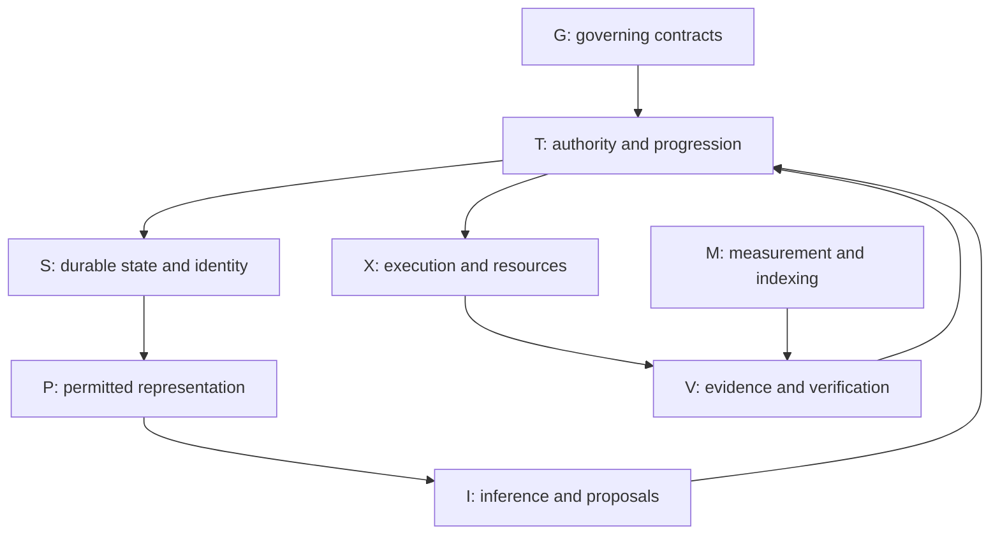

# Cross-repository ideas and techniques inventory

49 stable records: 11 MCP-Collaborative and 38 StateMachines. Major current-source subsystem groups have explicit dispositions. This is a source-grounded inventory, not a claim that every mechanism ran successfully or that all historical ideas were recovered.

The JSON below is the structured handoff. Each evidence entry provides an exact commit-pinned URL and available blob SHA. Unknown fields are null. Source-only uncertainty applies throughout.

```json
{
  "schema": "idea-technique-inventory/v1",
  "job_id": "job-007",
  "plan_step_id": "step-3",
  "worker_nonce": "worker-job007-step3-1792886192763",
  "scope": "Major current-source ideas, techniques, refinements and attempted controls across both pinned repositories; preserve selected prior evidence. Not exhaustive historical/deleted-data analysis.",
  "status": "current-source major-subsystem inventory reviewed",
  "record_count": 49,
  "repositories": [
    {
      "repository": "BestNameYet/MCP-Collaborative",
      "ref": "05ee655375695fbf48e0eeaab5ef2c561a565f78",
      "tree": "976e684c3841ab2313dfe476cfa9037962d1cdb9",
      "tree_entries": 52,
      "truncated": false
    },
    {
      "repository": "BestNameYet/StateMachines",
      "ref": "6ad9089083248ab3b9ed9d2fb91a9bc810345c0b",
      "tree": "e1899f7c84bcdae126a58153e1a86f1ed37844e0",
      "tree_entries": 2860,
      "truncated": false
    }
  ],
  "verification_boundary": "Read-only connected GitHub inspection. No workflow, runtime, model, browser or test execution. Source implementation, specification, test definition and historical result are separate labels. Unknown origin/problem metadata remains null.",
  "records": [
    {
      "id": "MCP-001",
      "name": "Specification-first application profiles",
      "repository": "BestNameYet/MCP-Collaborative",
      "ref": "05ee655375695fbf48e0eeaab5ef2c561a565f78",
      "subsystem": "governance",
      "problem": null,
      "mechanism": "Requires requirements, design, test plan, traceability, prioritization, implementation and verification in that order; governance ledgers must not silently create behavioral requirements.",
      "status_labels": [
        "proposed/specification"
      ],
      "evidence": [
        {
          "path": "APPLICATION_PROFILE_STANDARD.md",
          "symbol_or_section": "Governing Principle; Document Authority",
          "observation": "Requires requirements, design, test plan, traceability, prioritization, implementation and verification in that order; governance ledgers must not silently create behavioral requirements.",
          "blob_sha": "d5aa5fb75a66998b912aac8e609fc1eddf17a7ea",
          "url": "https://github.com/BestNameYet/MCP-Collaborative/blob/05ee655375695fbf48e0eeaab5ef2c561a565f78/APPLICATION_PROFILE_STANDARD.md"
        }
      ],
      "refinements": [],
      "related_ids": [],
      "uncertainty": "All profiles were not independently traced for conformance."
    },
    {
      "id": "MCP-002",
      "name": "Pure deterministic transition boundary",
      "repository": "BestNameYet/MCP-Collaborative",
      "ref": "05ee655375695fbf48e0eeaab5ef2c561a565f78",
      "subsystem": "tic-tac-toe",
      "problem": null,
      "mechanism": "Rejects wrong-game, terminal, malformed/stale revision, wrong actor and invalid cell actions; applies moves without I/O, clocks, randomness or strategy.",
      "status_labels": [
        "source-implemented"
      ],
      "evidence": [
        {
          "path": "plugins/collaborative-tic-tac-toe/src/collaborative_ttt/domain.py",
          "symbol_or_section": "apply_move",
          "observation": "Rejects wrong-game, terminal, malformed/stale revision, wrong actor and invalid cell actions; applies moves without I/O, clocks, randomness or strategy.",
          "blob_sha": "0166006d85acf33166f172601a9dbe05d241151c",
          "url": "https://github.com/BestNameYet/MCP-Collaborative/blob/05ee655375695fbf48e0eeaab5ef2c561a565f78/plugins/collaborative-tic-tac-toe/src/collaborative_ttt/domain.py"
        }
      ],
      "refinements": [],
      "related_ids": [
        "MCP-003",
        "MCP-006",
        "MCP-007"
      ],
      "uncertainty": "Source presence does not establish a successful live run or semantic correctness."
    },
    {
      "id": "MCP-003",
      "name": "Authoritative execution pointer",
      "repository": "BestNameYet/MCP-Collaborative",
      "ref": "05ee655375695fbf48e0eeaab5ef2c561a565f78",
      "subsystem": "orchestration",
      "problem": null,
      "mechanism": "Actor eligibility derives from authoritative turn state; actor/model chooses strategy but cannot take another actor's turn.",
      "status_labels": [
        "source-implemented"
      ],
      "evidence": [
        {
          "path": "plugins/collaborative-tic-tac-toe/src/collaborative_ttt/domain.py",
          "symbol_or_section": "GameState.active_actor_id; apply_move",
          "observation": "Actor eligibility derives from authoritative turn state; actor/model chooses strategy but cannot take another actor's turn.",
          "blob_sha": "0166006d85acf33166f172601a9dbe05d241151c",
          "url": "https://github.com/BestNameYet/MCP-Collaborative/blob/05ee655375695fbf48e0eeaab5ef2c561a565f78/plugins/collaborative-tic-tac-toe/src/collaborative_ttt/domain.py"
        }
      ],
      "refinements": [],
      "related_ids": [],
      "uncertainty": "Source presence does not establish a successful live run or semantic correctness."
    },
    {
      "id": "MCP-004",
      "name": "Allow-listed actor projections",
      "repository": "BestNameYet/MCP-Collaborative",
      "ref": "05ee655375695fbf48e0eeaab5ef2c561a565f78",
      "subsystem": "projection",
      "problem": null,
      "mechanism": "Builds explicit view fields, rejects unknown actor or unsupported perspective, and exposes current revision, available cells and is_your_turn.",
      "status_labels": [
        "source-implemented"
      ],
      "evidence": [
        {
          "path": "plugins/collaborative-tic-tac-toe/src/collaborative_ttt/projection.py",
          "symbol_or_section": "project_state",
          "observation": "Builds explicit view fields, rejects unknown actor or unsupported perspective, and exposes current revision, available cells and is_your_turn.",
          "blob_sha": "4bb162ba9caf69e509396b95a787220a02ab2e25",
          "url": "https://github.com/BestNameYet/MCP-Collaborative/blob/05ee655375695fbf48e0eeaab5ef2c561a565f78/plugins/collaborative-tic-tac-toe/src/collaborative_ttt/projection.py"
        }
      ],
      "refinements": [],
      "related_ids": [
        "MCP-005"
      ],
      "uncertainty": "Public board does not demonstrate stronger hidden-information isolation."
    },
    {
      "id": "MCP-005",
      "name": "Atomic state/events/environments persistence",
      "repository": "BestNameYet/MCP-Collaborative",
      "ref": "05ee655375695fbf48e0eeaab5ef2c561a565f78",
      "subsystem": "persistence",
      "problem": null,
      "mechanism": "SQLite BEGIN IMMEDIATE serializes mutation; game state, accepted events, action results and bounded actor-environment history share the authority boundary.",
      "status_labels": [
        "source-implemented"
      ],
      "evidence": [
        {
          "path": "plugins/collaborative-tic-tac-toe/src/collaborative_ttt/repository.py",
          "symbol_or_section": "create_game; _update_environments; submit_move",
          "observation": "SQLite BEGIN IMMEDIATE serializes mutation; game state, accepted events, action results and bounded actor-environment history share the authority boundary.",
          "blob_sha": "0f20fb604b50099a539479e13fbb0f774952177e",
          "url": "https://github.com/BestNameYet/MCP-Collaborative/blob/05ee655375695fbf48e0eeaab5ef2c561a565f78/plugins/collaborative-tic-tac-toe/src/collaborative_ttt/repository.py"
        }
      ],
      "refinements": [],
      "related_ids": [
        "SM-017"
      ],
      "uncertainty": "Source presence does not establish a successful live run or semantic correctness."
    },
    {
      "id": "MCP-006",
      "name": "Retry identity and stale-state separation",
      "repository": "BestNameYet/MCP-Collaborative",
      "ref": "05ee655375695fbf48e0eeaab5ef2c561a565f78",
      "subsystem": "idempotency",
      "problem": null,
      "mechanism": "Caches results by game/actor/action ID, replays identical canonical request JSON and rejects conflicting reuse; domain layer independently rejects stale revisions.",
      "status_labels": [
        "source-implemented"
      ],
      "evidence": [
        {
          "path": "plugins/collaborative-tic-tac-toe/src/collaborative_ttt/repository.py",
          "symbol_or_section": "submit_move",
          "observation": "Caches results by game/actor/action ID, replays identical canonical request JSON and rejects conflicting reuse; domain layer independently rejects stale revisions.",
          "blob_sha": "0f20fb604b50099a539479e13fbb0f774952177e",
          "url": "https://github.com/BestNameYet/MCP-Collaborative/blob/05ee655375695fbf48e0eeaab5ef2c561a565f78/plugins/collaborative-tic-tac-toe/src/collaborative_ttt/repository.py"
        }
      ],
      "refinements": [],
      "related_ids": [],
      "uncertainty": "Source presence does not establish a successful live run or semantic correctness."
    },
    {
      "id": "MCP-007",
      "name": "Genesis and event replay consistency",
      "repository": "BestNameYet/MCP-Collaborative",
      "ref": "05ee655375695fbf48e0eeaab5ef2c561a565f78",
      "subsystem": "verification",
      "problem": null,
      "mechanism": "Rebuilds from genesis plus ordered accepted events, checks sequence and reapplies deterministic moves before comparing authoritative state.",
      "status_labels": [
        "source-implemented"
      ],
      "evidence": [
        {
          "path": "plugins/collaborative-tic-tac-toe/src/collaborative_ttt/repository.py",
          "symbol_or_section": "verify_replay",
          "observation": "Rebuilds from genesis plus ordered accepted events, checks sequence and reapplies deterministic moves before comparing authoritative state.",
          "blob_sha": "0f20fb604b50099a539479e13fbb0f774952177e",
          "url": "https://github.com/BestNameYet/MCP-Collaborative/blob/05ee655375695fbf48e0eeaab5ef2c561a565f78/plugins/collaborative-tic-tac-toe/src/collaborative_ttt/repository.py"
        }
      ],
      "refinements": [],
      "related_ids": [],
      "uncertainty": "Source presence does not establish a successful live run or semantic correctness."
    },
    {
      "id": "MCP-008",
      "name": "Small bundled STDIO MCP surface",
      "repository": "BestNameYet/MCP-Collaborative",
      "ref": "05ee655375695fbf48e0eeaab5ef2c561a565f78",
      "subsystem": "interface",
      "problem": null,
      "mechanism": "Exposes four domain operations with retry/read annotations and host data-directory selection; server chooses no strategy.",
      "status_labels": [
        "source-implemented"
      ],
      "evidence": [
        {
          "path": "plugins/collaborative-tic-tac-toe/src/collaborative_ttt/mcp_server.py",
          "symbol_or_section": "create_game; get_actor_environment; submit_move; verify_replay",
          "observation": "Exposes four domain operations with retry/read annotations and host data-directory selection; server chooses no strategy.",
          "blob_sha": "64d0b652d3618429597b67ad4d920e913fb6161b",
          "url": "https://github.com/BestNameYet/MCP-Collaborative/blob/05ee655375695fbf48e0eeaab5ef2c561a565f78/plugins/collaborative-tic-tac-toe/src/collaborative_ttt/mcp_server.py"
        }
      ],
      "refinements": [],
      "related_ids": [],
      "uncertainty": "Host installation and actual tool exposure not checked."
    },
    {
      "id": "MCP-009",
      "name": "Commit-trigger HTTP relay",
      "repository": "BestNameYet/MCP-Collaborative",
      "ref": "05ee655375695fbf48e0eeaab5ef2c561a565f78",
      "subsystem": "integration",
      "problem": null,
      "mechanism": "Push/manual workflow reads script_ID and POSTs exact payload-file bytes with fail-with-body and HTTP status/effective URL diagnostics.",
      "status_labels": [
        "source-implemented"
      ],
      "evidence": [
        {
          "path": ".github/workflows/dispatch-relay-post.yml",
          "symbol_or_section": "POST message.json to ScriptAgent",
          "observation": "Push/manual workflow reads script_ID and POSTs exact payload-file bytes with fail-with-body and HTTP status/effective URL diagnostics.",
          "blob_sha": "560bd915257d8a76cbae5b094b8a95c92b66bdf0",
          "url": "https://github.com/BestNameYet/MCP-Collaborative/blob/05ee655375695fbf48e0eeaab5ef2c561a565f78/.github/workflows/dispatch-relay-post.yml"
        }
      ],
      "refinements": [],
      "related_ids": [
        "MCP-011"
      ],
      "uncertainty": "HTTP response would not independently prove downstream effect."
    },
    {
      "id": "MCP-010",
      "name": "Separate token and text counts",
      "repository": "BestNameYet/MCP-Collaborative",
      "ref": "05ee655375695fbf48e0eeaab5ef2c561a565f78",
      "subsystem": "token accounting",
      "problem": null,
      "mechanism": "Reports bytes, Unicode characters, words and o200k_base tokens for archived Issue1 text; explicitly distinguishes model-specific counts.",
      "status_labels": [
        "source-implemented"
      ],
      "evidence": [
        {
          "path": ".github/workflows/count-temp-text.yml",
          "symbol_or_section": "Node counting step",
          "observation": "Reports bytes, Unicode characters, words and o200k_base tokens for archived Issue1 text; explicitly distinguishes model-specific counts.",
          "blob_sha": "3b306791fda847a1bd25ad391a2a3639d9c66efa",
          "url": "https://github.com/BestNameYet/MCP-Collaborative/blob/05ee655375695fbf48e0eeaab5ef2c561a565f78/.github/workflows/count-temp-text.yml"
        }
      ],
      "refinements": [],
      "related_ids": [],
      "uncertainty": "Source presence does not establish a successful live run or semantic correctness."
    },
    {
      "id": "MCP-011",
      "name": "Spreadsheet-addressed function iterator",
      "repository": "BestNameYet/MCP-Collaborative",
      "ref": "05ee655375695fbf48e0eeaab5ef2c561a565f78",
      "subsystem": "Apps Script",
      "problem": null,
      "mechanism": "Loads a named range as function source, evaluates it, passes event/spreadsheet/input/address, follows output.next_address until terminal, then writes JSON to RESULT.",
      "status_labels": [
        "source-implemented"
      ],
      "evidence": [
        {
          "path": "Code.gs",
          "symbol_or_section": "doGet; doPost; runRequest",
          "observation": "Loads a named range as function source, evaluates it, passes event/spreadsheet/input/address, follows output.next_address until terminal, then writes JSON to RESULT.",
          "blob_sha": "9ea864dd95180a115ae462cf1c53188dfaad3b55",
          "url": "https://github.com/BestNameYet/MCP-Collaborative/blob/05ee655375695fbf48e0eeaab5ef2c561a565f78/Code.gs"
        }
      ],
      "refinements": [],
      "related_ids": [],
      "uncertainty": "Deployment/access policy and spreadsheet contents unavailable; evaluated source executes with Apps Script authority."
    },
    {
      "id": "SM-001",
      "name": "Nonce-scoped supervisory state machine",
      "repository": "BestNameYet/StateMachines",
      "ref": "6ad9089083248ab3b9ed9d2fb91a9bc810345c0b",
      "subsystem": "Supervisor",
      "problem": null,
      "mechanism": "Loads shared contract/config, validates step returns, persists run-specific state and gates step advancement on evaluator pass/fail.",
      "status_labels": [
        "source-implemented"
      ],
      "evidence": [
        {
          "path": "ChatMachines/GeminiSupervisor/send-to-gemini.js",
          "symbol_or_section": "initRun; validateStep; transition execution",
          "observation": "Loads shared contract/config, validates step returns, persists run-specific state and gates step advancement on evaluator pass/fail.",
          "blob_sha": "598320ffeecb7a928ab9549a1703fd8e05a5d926",
          "url": "https://github.com/BestNameYet/StateMachines/blob/6ad9089083248ab3b9ed9d2fb91a9bc810345c0b/ChatMachines/GeminiSupervisor/send-to-gemini.js"
        }
      ],
      "refinements": [],
      "related_ids": [
        "SM-002",
        "SM-003",
        "SM-004"
      ],
      "uncertainty": "Source presence does not establish a successful live run or semantic correctness."
    },
    {
      "id": "SM-002",
      "name": "Repository-grounded execution claims",
      "repository": "BestNameYet/StateMachines",
      "ref": "6ad9089083248ab3b9ed9d2fb91a9bc810345c0b",
      "subsystem": "Supervisor verification",
      "problem": null,
      "mechanism": "Resolves evidence locators to current files/blobs/commits; unresolved external evidence becomes an explicit finding.",
      "status_labels": [
        "source-implemented"
      ],
      "evidence": [
        {
          "path": "ChatMachines/GeminiSupervisor/send-to-gemini.js",
          "symbol_or_section": "collectGroundTruth; fileFinding; gitObjectFinding",
          "observation": "Resolves evidence locators to current files/blobs/commits; unresolved external evidence becomes an explicit finding.",
          "blob_sha": "598320ffeecb7a928ab9549a1703fd8e05a5d926",
          "url": "https://github.com/BestNameYet/StateMachines/blob/6ad9089083248ab3b9ed9d2fb91a9bc810345c0b/ChatMachines/GeminiSupervisor/send-to-gemini.js"
        }
      ],
      "refinements": [],
      "related_ids": [],
      "uncertainty": "Cannot independently establish arbitrary external-system effects."
    },
    {
      "id": "SM-003",
      "name": "Paired specification/runtime revision",
      "repository": "BestNameYet/StateMachines",
      "ref": "6ad9089083248ab3b9ed9d2fb91a9bc810345c0b",
      "subsystem": "evaluator",
      "problem": null,
      "mechanism": "Requests complete paired contract/runtime revisions and shared external dependency config; mechanically enforces preserved JSON pointers.",
      "status_labels": [
        "source-implemented",
        "proposed/specification"
      ],
      "evidence": [
        {
          "path": "ChatMachines/GeminiEvaluation/evaluate-supervisor.js",
          "symbol_or_section": "buildSystemInstruction; assertPreservedPointers",
          "observation": "Requests complete paired contract/runtime revisions and shared external dependency config; mechanically enforces preserved JSON pointers.",
          "blob_sha": "ccf4e456b4795ce89bbda8ce3790f64cc90c830e",
          "url": "https://github.com/BestNameYet/StateMachines/blob/6ad9089083248ab3b9ed9d2fb91a9bc810345c0b/ChatMachines/GeminiEvaluation/evaluate-supervisor.js"
        }
      ],
      "refinements": [],
      "related_ids": [],
      "uncertainty": "Generated candidate content still needs review and promotion."
    },
    {
      "id": "SM-004",
      "name": "Isolated nextmessage devices",
      "repository": "BestNameYet/StateMachines",
      "ref": "6ad9089083248ab3b9ed9d2fb91a9bc810345c0b",
      "subsystem": "routing",
      "problem": null,
      "mechanism": "Different commit-mutated message paths trigger Supervisor, evaluator and historical audit; input surfaces and nonce-scoped output directories remain distinct.",
      "status_labels": [
        "proposed/specification"
      ],
      "evidence": [
        {
          "path": "ChatMachines/GeminiEvaluation/README.md",
          "symbol_or_section": "Routing chart; Isolation convention",
          "observation": "Different commit-mutated message paths trigger Supervisor, evaluator and historical audit; input surfaces and nonce-scoped output directories remain distinct.",
          "blob_sha": "4e2212166279bd77e49420c987b4ccdfd0f815b3",
          "url": "https://github.com/BestNameYet/StateMachines/blob/6ad9089083248ab3b9ed9d2fb91a9bc810345c0b/ChatMachines/GeminiEvaluation/README.md"
        }
      ],
      "refinements": [],
      "related_ids": [],
      "uncertainty": "Architecture documented; every workflow route not individually executed."
    },
    {
      "id": "SM-005",
      "name": "Hierarchical evaluation with retry policies",
      "repository": "BestNameYet/StateMachines",
      "ref": "6ad9089083248ab3b9ed9d2fb91a9bc810345c0b",
      "subsystem": "evaluation runtime",
      "problem": null,
      "mechanism": "Divides context, invokes configured evaluators, normalizes responses, checks acceptance/retry conditions, aggregates and evaluates termination.",
      "status_labels": [
        "source-implemented"
      ],
      "evidence": [
        {
          "path": "ChatMachines/GeminiEvaluation/hierarchical-runtime/audit.js",
          "symbol_or_section": "runHierarchicalEvaluation; divideContextIntoBatches; processBatch",
          "observation": "Divides context, invokes configured evaluators, normalizes responses, checks acceptance/retry conditions, aggregates and evaluates termination.",
          "blob_sha": "3e60f9a93f23d190cdd3510ce297315e74e16529",
          "url": "https://github.com/BestNameYet/StateMachines/blob/6ad9089083248ab3b9ed9d2fb91a9bc810345c0b/ChatMachines/GeminiEvaluation/hierarchical-runtime/audit.js"
        }
      ],
      "refinements": [],
      "related_ids": [
        "SM-006",
        "SM-037"
      ],
      "uncertainty": "Source presence does not establish a successful live run or semantic correctness."
    },
    {
      "id": "SM-006",
      "name": "Checkpointed historical feature inventory",
      "repository": "BestNameYet/StateMachines",
      "ref": "6ad9089083248ab3b9ed9d2fb91a9bc810345c0b",
      "subsystem": "inventory",
      "problem": null,
      "mechanism": "Persisted final report records 41 features, ten successful batches and zero failed batches; sibling runner saves batch/round/state and reuses successful B0 checkpoints.",
      "status_labels": [
        "historical-result",
        "source-implemented"
      ],
      "evidence": [
        {
          "path": "ChatMachines/GeminiEvaluation/evaluations/stage1_current_feature_inventory_20261002_1/execution/final.json",
          "symbol_or_section": "final_inventory; supervisory_summary",
          "observation": "Persisted final report records 41 features, ten successful batches and zero failed batches; sibling runner saves batch/round/state and reuses successful B0 checkpoints.",
          "blob_sha": "1fcbc7b1344b9e22944a40fca1a64c1d71b3a2c7",
          "url": "https://github.com/BestNameYet/StateMachines/blob/6ad9089083248ab3b9ed9d2fb91a9bc810345c0b/ChatMachines/GeminiEvaluation/evaluations/stage1_current_feature_inventory_20261002_1/execution/final.json"
        },
        {
          "path": "ChatMachines/GeminiEvaluation/evaluations/stage1_current_feature_inventory_20261002_1/run-stage1.js",
          "symbol_or_section": null,
          "observation": "Supporting source for the mechanism described in this record.",
          "blob_sha": "d4f41233feed97d8caadd30d5d2e9efe09472bf5",
          "url": "https://github.com/BestNameYet/StateMachines/blob/6ad9089083248ab3b9ed9d2fb91a9bc810345c0b/ChatMachines/GeminiEvaluation/evaluations/stage1_current_feature_inventory_20261002_1/run-stage1.js"
        }
      ],
      "refinements": [],
      "related_ids": [],
      "uncertainty": "Limited to GeminiSupervisor; no rerun and not whole-repository coverage."
    },
    {
      "id": "SM-007",
      "name": "Ordered readers with source provenance",
      "repository": "BestNameYet/StateMachines",
      "ref": "6ad9089083248ab3b9ed9d2fb91a9bc810345c0b",
      "subsystem": "readers",
      "problem": null,
      "mechanism": "Converts canonical source to ordered items and records source blob, source commit and reader blob identities.",
      "status_labels": [
        "source-implemented"
      ],
      "evidence": [
        {
          "path": "ChatMachines/GeminiSupervisor/scripts/sync-stable-readers.js",
          "symbol_or_section": "buildReader; syncStableReaders",
          "observation": "Converts canonical source to ordered items and records source blob, source commit and reader blob identities.",
          "blob_sha": "389fc695a01d965513d300fc6eae33a9a7a75099",
          "url": "https://github.com/BestNameYet/StateMachines/blob/6ad9089083248ab3b9ed9d2fb91a9bc810345c0b/ChatMachines/GeminiSupervisor/scripts/sync-stable-readers.js"
        }
      ],
      "refinements": [],
      "related_ids": [
        "SM-008",
        "SM-009"
      ],
      "uncertainty": "Source presence does not establish a successful live run or semantic correctness."
    },
    {
      "id": "SM-008",
      "name": "Controlled-damage truth challenge",
      "repository": "BestNameYet/StateMachines",
      "ref": "6ad9089083248ab3b9ed9d2fb91a9bc810345c0b",
      "subsystem": "attempted control",
      "problem": null,
      "mechanism": "Checks reader provenance, builds full projections and introduces controlled distributed damage for reconstruction checks.",
      "status_labels": [
        "source-implemented"
      ],
      "evidence": [
        {
          "path": "ChatMachines/GeminiSupervisor/scripts/truth-challenge-engine.js",
          "symbol_or_section": "verifyStableReader; damageProjection; selectDistributedIndices",
          "observation": "Checks reader provenance, builds full projections and introduces controlled distributed damage for reconstruction checks.",
          "blob_sha": "411ab7ca762074e1509a43f024ad10c6d19018c3",
          "url": "https://github.com/BestNameYet/StateMachines/blob/6ad9089083248ab3b9ed9d2fb91a9bc810345c0b/ChatMachines/GeminiSupervisor/scripts/truth-challenge-engine.js"
        }
      ],
      "refinements": [],
      "related_ids": [],
      "uncertainty": "Challenge success alone cannot prove comprehension of substantive instructions."
    },
    {
      "id": "SM-009",
      "name": "PNG locator challenge and deterministic solver",
      "repository": "BestNameYet/StateMachines",
      "ref": "6ad9089083248ab3b9ed9d2fb91a9bc810345c0b",
      "subsystem": "attempted control",
      "problem": null,
      "mechanism": "Mixed slots are rendered into randomized PNG cards and ordered locators are verified; companion solve-png-locator maps rendered candidates with row hashes.",
      "status_labels": [
        "source-implemented"
      ],
      "evidence": [
        {
          "path": "ChatMachines/GeminiSupervisor/scripts/live-ground-truth-reading-room.js",
          "symbol_or_section": "card rendering; verifyLocator",
          "observation": "Mixed slots are rendered into randomized PNG cards and ordered locators are verified; companion solve-png-locator maps rendered candidates with row hashes.",
          "blob_sha": "ad4151a52e5280cfb6666a9512586e9abfd45e74",
          "url": "https://github.com/BestNameYet/StateMachines/blob/6ad9089083248ab3b9ed9d2fb91a9bc810345c0b/ChatMachines/GeminiSupervisor/scripts/live-ground-truth-reading-room.js"
        },
        {
          "path": "ChatMachines/GeminiSupervisor/scripts/solve-png-locator.js",
          "symbol_or_section": null,
          "observation": "Supporting source for the mechanism described in this record.",
          "blob_sha": "2fc71be76bae3bce3d48af4bd877f69e4f386cd1",
          "url": "https://github.com/BestNameYet/StateMachines/blob/6ad9089083248ab3b9ed9d2fb91a9bc810345c0b/ChatMachines/GeminiSupervisor/scripts/solve-png-locator.js"
        }
      ],
      "refinements": [],
      "related_ids": [],
      "uncertainty": "Deterministic companion solver limits interpreting successful locator output as independent visual comprehension."
    },
    {
      "id": "SM-010",
      "name": "Persisted interactive modes and recovery",
      "repository": "BestNameYet/StateMachines",
      "ref": "6ad9089083248ab3b9ed9d2fb91a9bc810345c0b",
      "subsystem": "AGENTS Procedure",
      "problem": null,
      "mechanism": "Maintains screens/variables/mode and pending response state; saved command-only responses resume without reissuing completed commands.",
      "status_labels": [
        "source-implemented"
      ],
      "evidence": [
        {
          "path": "ChatMachines/Workflow Interactive Procedures/AGENTS Procedure/gemini-workflow.js",
          "symbol_or_section": "generateGeminiScreen",
          "observation": "Maintains screens/variables/mode and pending response state; saved command-only responses resume without reissuing completed commands.",
          "blob_sha": "5606cc5721ee7c6b2f441d446c86b2d7e583296d",
          "url": "https://github.com/BestNameYet/StateMachines/blob/6ad9089083248ab3b9ed9d2fb91a9bc810345c0b/ChatMachines/Workflow%20Interactive%20Procedures/AGENTS%20Procedure/gemini-workflow.js"
        }
      ],
      "refinements": [],
      "related_ids": [
        "SM-011",
        "SM-012",
        "SM-013"
      ],
      "uncertainty": "Source presence does not establish a successful live run or semantic correctness."
    },
    {
      "id": "SM-011",
      "name": "Outcome/process gaps and stall control",
      "repository": "BestNameYet/StateMachines",
      "ref": "6ad9089083248ab3b9ed9d2fb91a9bc810345c0b",
      "subsystem": "AGENTS Procedure",
      "problem": null,
      "mechanism": "Validates target/current outcome and process, explicit gaps and progress descriptions; procedure documentation defines three consecutive no-progress turns as incomplete termination.",
      "status_labels": [
        "source-implemented",
        "proposed/specification"
      ],
      "evidence": [
        {
          "path": "ChatMachines/Workflow Interactive Procedures/AGENTS Procedure/gemini-workflow.js",
          "symbol_or_section": "validateControl; generation state updates",
          "observation": "Validates target/current outcome and process, explicit gaps and progress descriptions; procedure documentation defines three consecutive no-progress turns as incomplete termination.",
          "blob_sha": "5606cc5721ee7c6b2f441d446c86b2d7e583296d",
          "url": "https://github.com/BestNameYet/StateMachines/blob/6ad9089083248ab3b9ed9d2fb91a9bc810345c0b/ChatMachines/Workflow%20Interactive%20Procedures/AGENTS%20Procedure/gemini-workflow.js"
        }
      ],
      "refinements": [],
      "related_ids": [],
      "uncertainty": "Model judges semantic progress; structural validity is narrower."
    },
    {
      "id": "SM-012",
      "name": "Worker identity with serialized shared mutations",
      "repository": "BestNameYet/StateMachines",
      "ref": "6ad9089083248ab3b9ed9d2fb91a9bc810345c0b",
      "subsystem": "workers",
      "problem": null,
      "mechanism": "Workers choose/reuse nonce identities, receive bounded assignment/menu/context, and return values/files; promise chain serializes shared mutations while independent requests can proceed.",
      "status_labels": [
        "source-implemented"
      ],
      "evidence": [
        {
          "path": "ChatMachines/Workflow Interactive Procedures/AGENTS Procedure/gemini-workers.js",
          "symbol_or_section": "runGeminiWorkers",
          "observation": "Workers choose/reuse nonce identities, receive bounded assignment/menu/context, and return values/files; promise chain serializes shared mutations while independent requests can proceed.",
          "blob_sha": "9fb334576daee159151c5db81058deb98af62bc9",
          "url": "https://github.com/BestNameYet/StateMachines/blob/6ad9089083248ab3b9ed9d2fb91a9bc810345c0b/ChatMachines/Workflow%20Interactive%20Procedures/AGENTS%20Procedure/gemini-workers.js"
        }
      ],
      "refinements": [],
      "related_ids": [],
      "uncertainty": "Source presence does not establish a successful live run or semantic correctness."
    },
    {
      "id": "SM-013",
      "name": "Mirror mode control variant",
      "repository": "BestNameYet/StateMachines",
      "ref": "6ad9089083248ab3b9ed9d2fb91a9bc810345c0b",
      "subsystem": "AGENTS Procedure",
      "problem": null,
      "mechanism": "Dedicated mirror phase and return path preserve a distinct control variant.",
      "status_labels": [
        "source-implemented"
      ],
      "evidence": [
        {
          "path": "ChatMachines/Workflow Interactive Procedures/AGENTS Procedure/mirror-workflow.js",
          "symbol_or_section": "beginMirror; mirrorInstruction; applyMirrorReturn",
          "observation": "Dedicated mirror phase and return path preserve a distinct control variant.",
          "blob_sha": "d4c3942b8643714ac0aa6362b7fb4974d3712acc",
          "url": "https://github.com/BestNameYet/StateMachines/blob/6ad9089083248ab3b9ed9d2fb91a9bc810345c0b/ChatMachines/Workflow%20Interactive%20Procedures/AGENTS%20Procedure/mirror-workflow.js"
        }
      ],
      "refinements": [],
      "related_ids": [],
      "uncertainty": "Every mirror transition and completion condition not fully audited."
    },
    {
      "id": "SM-014",
      "name": "Owner-scoped command and receipt surface",
      "repository": "BestNameYet/StateMachines",
      "ref": "6ad9089083248ab3b9ed9d2fb91a9bc810345c0b",
      "subsystem": "commands",
      "problem": null,
      "mechanism": "Explicit marker/envelope and origin-issue receipts route catalog operations; user catalog excludes issue APIs and unrestricted GraphQL.",
      "status_labels": [
        "source-implemented"
      ],
      "evidence": [
        {
          "path": "ChatMachines/Workflow Interactive Procedures/GitHub Command Issue/issue-command.js",
          "symbol_or_section": "parse; requestFor; run",
          "observation": "Explicit marker/envelope and origin-issue receipts route catalog operations; user catalog excludes issue APIs and unrestricted GraphQL.",
          "blob_sha": "1790110ec5d8f58745a7bc998b23ba0d9aa25dea",
          "url": "https://github.com/BestNameYet/StateMachines/blob/6ad9089083248ab3b9ed9d2fb91a9bc810345c0b/ChatMachines/Workflow%20Interactive%20Procedures/GitHub%20Command%20Issue/issue-command.js"
        }
      ],
      "refinements": [],
      "related_ids": [
        "SM-015"
      ],
      "uncertainty": "Catalog breadth is not credential permission."
    },
    {
      "id": "SM-015",
      "name": "Native reads with workspace boundaries",
      "repository": "BestNameYet/StateMachines",
      "ref": "6ad9089083248ab3b9ed9d2fb91a9bc810345c0b",
      "subsystem": "commands",
      "problem": null,
      "mechanism": "Rejects absolute/traversal paths and symlinks, checks real paths, regular files and byte limits, and closes descriptors.",
      "status_labels": [
        "source-implemented"
      ],
      "evidence": [
        {
          "path": "ChatMachines/Workflow Interactive Procedures/GitHub Command Issue/issue-command.js",
          "symbol_or_section": "localRead; localStat",
          "observation": "Rejects absolute/traversal paths and symlinks, checks real paths, regular files and byte limits, and closes descriptors.",
          "blob_sha": "1790110ec5d8f58745a7bc998b23ba0d9aa25dea",
          "url": "https://github.com/BestNameYet/StateMachines/blob/6ad9089083248ab3b9ed9d2fb91a9bc810345c0b/ChatMachines/Workflow%20Interactive%20Procedures/GitHub%20Command%20Issue/issue-command.js"
        }
      ],
      "refinements": [],
      "related_ids": [],
      "uncertainty": "Does not establish migration of every catalog operation to local execution."
    },
    {
      "id": "SM-016",
      "name": "Seal/delete/evaluate lifecycle",
      "repository": "BestNameYet/StateMachines",
      "ref": "6ad9089083248ab3b9ed9d2fb91a9bc810345c0b",
      "subsystem": "SBE",
      "problem": null,
      "mechanism": "Seal workflow checks trusted main/request and single submission; finalizer persists encrypted payload and deletion marker; follow-up verifies marker/artifact, deletes branch, then generates nonce and evaluates encrypted return.",
      "status_labels": [
        "source-implemented"
      ],
      "evidence": [
        {
          "path": ".github/workflows/sbe-delete-branch.yml",
          "symbol_or_section": "Verify delete marker; Close pull request; Create evaluation nonce",
          "observation": "Seal workflow checks trusted main/request and single submission; finalizer persists encrypted payload and deletion marker; follow-up verifies marker/artifact, deletes branch, then generates nonce and evaluates encrypted return.",
          "blob_sha": "0df0b0dfcd8f5e3eba9b62191cde667ed26a2e56",
          "url": "https://github.com/BestNameYet/StateMachines/blob/6ad9089083248ab3b9ed9d2fb91a9bc810345c0b/.github/workflows/sbe-delete-branch.yml"
        },
        {
          "path": ".github/workflows/sbe-seal-evaluate.yml",
          "symbol_or_section": null,
          "observation": "Supporting source for the mechanism described in this record.",
          "blob_sha": "68fe6662c1a2f2c1f8ba8afb342c14bf080f200d",
          "url": "https://github.com/BestNameYet/StateMachines/blob/6ad9089083248ab3b9ed9d2fb91a9bc810345c0b/.github/workflows/sbe-seal-evaluate.yml"
        },
        {
          "path": "ChatMachines/SBE/sbe-pack.js",
          "symbol_or_section": null,
          "observation": "Supporting source for the mechanism described in this record.",
          "blob_sha": "b90ca3de1844050e20cd097af026dc6dc7acc5ab",
          "url": "https://github.com/BestNameYet/StateMachines/blob/6ad9089083248ab3b9ed9d2fb91a9bc810345c0b/ChatMachines/SBE/sbe-pack.js"
        },
        {
          "path": "ChatMachines/SBE/sbe-finalize.js",
          "symbol_or_section": null,
          "observation": "Supporting source for the mechanism described in this record.",
          "blob_sha": "abc26ee766d74754eb19ae5f9f5a27bc51c268ea",
          "url": "https://github.com/BestNameYet/StateMachines/blob/6ad9089083248ab3b9ed9d2fb91a9bc810345c0b/ChatMachines/SBE/sbe-finalize.js"
        },
        {
          "path": "ChatMachines/SBE/sbe-evaluate.js",
          "symbol_or_section": null,
          "observation": "Supporting source for the mechanism described in this record.",
          "blob_sha": "fd9270b17b97974d64c775eda1a5915343983098",
          "url": "https://github.com/BestNameYet/StateMachines/blob/6ad9089083248ab3b9ed9d2fb91a9bc810345c0b/ChatMachines/SBE/sbe-evaluate.js"
        },
        {
          "path": "ChatMachines/SBE/sbe-validate-evaluator-return.js",
          "symbol_or_section": null,
          "observation": "Supporting source for the mechanism described in this record.",
          "blob_sha": "6f38232896a7880b6d4a33b1f4d3b8b8467db604",
          "url": "https://github.com/BestNameYet/StateMachines/blob/6ad9089083248ab3b9ed9d2fb91a9bc810345c0b/ChatMachines/SBE/sbe-validate-evaluator-return.js"
        }
      ],
      "refinements": [],
      "related_ids": [],
      "uncertainty": "No real lifecycle run or security audit; validator separately enforces exact result/nonce keys."
    },
    {
      "id": "SM-017",
      "name": "Version-pinned transaction behaviors",
      "repository": "BestNameYet/StateMachines",
      "ref": "6ad9089083248ab3b9ed9d2fb91a9bc810345c0b",
      "subsystem": "AIChannel",
      "problem": null,
      "mechanism": "Stable ai_channel dispatches versioned JSON behaviors; explicit transaction handles persist state and remain pinned to config version; SQLite store uses BEGIN IMMEDIATE and expected-version comparison.",
      "status_labels": [
        "source-implemented"
      ],
      "evidence": [
        {
          "path": "untrusted AI/meta-procedure/AIChannel/aichannel/runtime.py",
          "symbol_or_section": "configure; _state_machine; invoke",
          "observation": "Stable ai_channel dispatches versioned JSON behaviors; explicit transaction handles persist state and remain pinned to config version; SQLite store uses BEGIN IMMEDIATE and expected-version comparison.",
          "blob_sha": "cd0adbb277ec3977617df501ccd4dd116e13ee41",
          "url": "https://github.com/BestNameYet/StateMachines/blob/6ad9089083248ab3b9ed9d2fb91a9bc810345c0b/untrusted%20AI/meta-procedure/AIChannel/aichannel/runtime.py"
        },
        {
          "path": "untrusted AI/meta-procedure/AIChannel/aichannel/store.py",
          "symbol_or_section": null,
          "observation": "Supporting source for the mechanism described in this record.",
          "blob_sha": "27837fa071609362c567d3a15e1bd7588c3f059f",
          "url": "https://github.com/BestNameYet/StateMachines/blob/6ad9089083248ab3b9ed9d2fb91a9bc810345c0b/untrusted%20AI/meta-procedure/AIChannel/aichannel/store.py"
        }
      ],
      "refinements": [],
      "related_ids": [
        "SM-034"
      ],
      "uncertainty": "Event appends and state updates require separate transactionality review."
    },
    {
      "id": "SM-018",
      "name": "Sequential meta-procedure script adapter",
      "repository": "BestNameYet/StateMachines",
      "ref": "6ad9089083248ab3b9ed9d2fb91a9bc810345c0b",
      "subsystem": "meta-procedure",
      "problem": null,
      "mechanism": "Discovers procedure script nodes and runs child scripts sequentially with arguments and exit outcomes.",
      "status_labels": [
        "source-implemented"
      ],
      "evidence": [
        {
          "path": "untrusted AI/meta-procedure/Procedures/JS Runner/js-runner.js",
          "symbol_or_section": "findScriptNodes; executeScript; run",
          "observation": "Discovers procedure script nodes and runs child scripts sequentially with arguments and exit outcomes.",
          "blob_sha": "4bade328f43c526fd7afde105fccf0196cc0d7d2",
          "url": "https://github.com/BestNameYet/StateMachines/blob/6ad9089083248ab3b9ed9d2fb91a9bc810345c0b/untrusted%20AI/meta-procedure/Procedures/JS%20Runner/js-runner.js"
        }
      ],
      "refinements": [],
      "related_ids": [
        "SM-019",
        "SM-035",
        "SM-038"
      ],
      "uncertainty": "Child execution is not proof of requested remote effects."
    },
    {
      "id": "SM-019",
      "name": "Ordered archive operations and independent readback",
      "repository": "BestNameYet/StateMachines",
      "ref": "6ad9089083248ab3b9ed9d2fb91a9bc810345c0b",
      "subsystem": "archive extraction",
      "problem": null,
      "mechanism": "Implements inspect/copy/list/extract, caches unzip results, checks requested/ambiguous names, obeys stop/continue, records output IDs and source size/time preservation; report explicitly requires independent Drive readback.",
      "status_labels": [
        "source-implemented",
        "proposed/specification"
      ],
      "evidence": [
        {
          "path": "metaprocedures/procedures/AchiveExtraction/apps-script-source.js",
          "symbol_or_section": "action loop; report construction",
          "observation": "Implements inspect/copy/list/extract, caches unzip results, checks requested/ambiguous names, obeys stop/continue, records output IDs and source size/time preservation; report explicitly requires independent Drive readback.",
          "blob_sha": "db56e9dae021b5c0a274adc2cba45158455f9316",
          "url": "https://github.com/BestNameYet/StateMachines/blob/6ad9089083248ab3b9ed9d2fb91a9bc810345c0b/metaprocedures/procedures/AchiveExtraction/apps-script-source.js"
        },
        {
          "path": "metaprocedures/procedures/AchiveExtraction/README.md",
          "symbol_or_section": null,
          "observation": "Supporting source for the mechanism described in this record.",
          "blob_sha": "770215ccb3f95318eeb66aa03e5d3443605409bd",
          "url": "https://github.com/BestNameYet/StateMachines/blob/6ad9089083248ab3b9ed9d2fb91a9bc810345c0b/metaprocedures/procedures/AchiveExtraction/README.md"
        }
      ],
      "refinements": [],
      "related_ids": [],
      "uncertainty": "Unzip is whole-blob; no live deployment or end-to-end recovery proof."
    },
    {
      "id": "SM-020",
      "name": "Question-specific evidence and coverage ledger",
      "repository": "BestNameYet/StateMachines",
      "ref": "6ad9089083248ab3b9ed9d2fb91a9bc810345c0b",
      "subsystem": "archive analysis",
      "problem": null,
      "mechanism": "Separates inventoried/searched/read/analyzed/synthesized/verified, stable references, branch preservation and per-question completeness.",
      "status_labels": [
        "proposed/specification"
      ],
      "evidence": [
        {
          "path": "ChatMachines/Workflow Interactive Procedures/Conversation Archive Analysis/README.md",
          "symbol_or_section": "Coverage and evidence; Analysis matrix",
          "observation": "Separates inventoried/searched/read/analyzed/synthesized/verified, stable references, branch preservation and per-question completeness.",
          "blob_sha": "d717793ac54aceebef104e336f7b2aa51b8322c9",
          "url": "https://github.com/BestNameYet/StateMachines/blob/6ad9089083248ab3b9ed9d2fb91a9bc810345c0b/ChatMachines/Workflow%20Interactive%20Procedures/Conversation%20Archive%20Analysis/README.md"
        }
      ],
      "refinements": [],
      "related_ids": [
        "SM-021",
        "SM-022",
        "SM-026"
      ],
      "uncertainty": "Overview's preparation-outstanding statement conflicts with later implemented pipelines; treat as a stale outline."
    },
    {
      "id": "SM-021",
      "name": "Independent multimodal analysis jobs",
      "repository": "BestNameYet/StateMachines",
      "ref": "6ad9089083248ab3b9ed9d2fb91a9bc810345c0b",
      "subsystem": "parallel analysis",
      "problem": null,
      "mechanism": "Collects source hash/byte manifests, rejects unsupported inputs, sends assignment text/images and checks image-answer identity; collection distinguishes failed/missing jobs.",
      "status_labels": [
        "source-implemented"
      ],
      "evidence": [
        {
          "path": "ChatMachines/Workflow Interactive Procedures/Conversation Archive Analysis/parallel-gemini/run_task.py",
          "symbol_or_section": "collect; call; validate_image_answer; run",
          "observation": "Collects source hash/byte manifests, rejects unsupported inputs, sends assignment text/images and checks image-answer identity; collection distinguishes failed/missing jobs.",
          "blob_sha": "33c471137ca3efd4648e66f4be89bc1bad579da8",
          "url": "https://github.com/BestNameYet/StateMachines/blob/6ad9089083248ab3b9ed9d2fb91a9bc810345c0b/ChatMachines/Workflow%20Interactive%20Procedures/Conversation%20Archive%20Analysis/parallel-gemini/run_task.py"
        }
      ],
      "refinements": [],
      "related_ids": [],
      "uncertainty": "Source presence does not establish a successful live run or semantic correctness."
    },
    {
      "id": "SM-022",
      "name": "Unsupervised lexical topic baseline",
      "repository": "BestNameYet/StateMachines",
      "ref": "6ad9089083248ab3b9ed9d2fb91a9bc810345c0b",
      "subsystem": "topics",
      "problem": null,
      "mechanism": "Checks source checksums/counts, extracts explicit text with references and fits TF-IDF/NMF; normalized activations are not probabilities.",
      "status_labels": [
        "source-implemented"
      ],
      "evidence": [
        {
          "path": "ChatMachines/Workflow Interactive Procedures/Conversation Archive Analysis/tfidf-nmf/run.py",
          "symbol_or_section": "prepare_bin; documents_for; fit",
          "observation": "Checks source checksums/counts, extracts explicit text with references and fits TF-IDF/NMF; normalized activations are not probabilities.",
          "blob_sha": "3e875f016b08b24266f9eb259b50e84ddf5af03e",
          "url": "https://github.com/BestNameYet/StateMachines/blob/6ad9089083248ab3b9ed9d2fb91a9bc810345c0b/ChatMachines/Workflow%20Interactive%20Procedures/Conversation%20Archive%20Analysis/tfidf-nmf/run.py"
        }
      ],
      "refinements": [],
      "related_ids": [
        "SM-023",
        "SM-024",
        "SM-025"
      ],
      "uncertainty": "Source presence does not establish a successful live run or semantic correctness."
    },
    {
      "id": "SM-023",
      "name": "Approximate topic catalog consolidation",
      "repository": "BestNameYet/StateMachines",
      "ref": "6ad9089083248ab3b9ed9d2fb91a9bc810345c0b",
      "subsystem": "topics",
      "problem": null,
      "mechanism": "Aligns vocabulary, optional local IDF adjustment, normalized similarity and complete-linkage constraints; preserves crosswalk/source weights.",
      "status_labels": [
        "source-implemented"
      ],
      "evidence": [
        {
          "path": "ChatMachines/Workflow Interactive Procedures/Conversation Archive Analysis/topic-merge/merge.py",
          "symbol_or_section": "cluster_topics; remap_topics; merge",
          "observation": "Aligns vocabulary, optional local IDF adjustment, normalized similarity and complete-linkage constraints; preserves crosswalk/source weights.",
          "blob_sha": "ace312eb84340ac06a16e0741b39ca71c8bd1752",
          "url": "https://github.com/BestNameYet/StateMachines/blob/6ad9089083248ab3b9ed9d2fb91a9bc810345c0b/ChatMachines/Workflow%20Interactive%20Procedures/Conversation%20Archive%20Analysis/topic-merge/merge.py"
        }
      ],
      "refinements": [],
      "related_ids": [],
      "uncertainty": "Consolidation is not globally fitted NMF."
    },
    {
      "id": "SM-024",
      "name": "Hierarchical groups and unique conversation counts",
      "repository": "BestNameYet/StateMachines",
      "ref": "6ad9089083248ab3b9ed9d2fb91a9bc810345c0b",
      "subsystem": "topics",
      "problem": null,
      "mechanism": "Average-linkage cosine hierarchy supports configurable cuts; count.py enforces conversation uniqueness/counts and computes dominant plus overlapping membership using saved weights.",
      "status_labels": [
        "source-implemented"
      ],
      "evidence": [
        {
          "path": "ChatMachines/Workflow Interactive Procedures/Conversation Archive Analysis/topic-clustering/cluster.py",
          "symbol_or_section": "hierarchy; groups_at",
          "observation": "Average-linkage cosine hierarchy supports configurable cuts; count.py enforces conversation uniqueness/counts and computes dominant plus overlapping membership using saved weights.",
          "blob_sha": "6b7b8e5f90bc1b99a547ba354b58b74862d909b4",
          "url": "https://github.com/BestNameYet/StateMachines/blob/6ad9089083248ab3b9ed9d2fb91a9bc810345c0b/ChatMachines/Workflow%20Interactive%20Procedures/Conversation%20Archive%20Analysis/topic-clustering/cluster.py"
        },
        {
          "path": "ChatMachines/Workflow Interactive Procedures/Conversation Archive Analysis/topic-distribution/count.py",
          "symbol_or_section": null,
          "observation": "Supporting source for the mechanism described in this record.",
          "blob_sha": "97b933a7d75c880ffa8dca82ca79d8c537a0bb53",
          "url": "https://github.com/BestNameYet/StateMachines/blob/6ad9089083248ab3b9ed9d2fb91a9bc810345c0b/ChatMachines/Workflow%20Interactive%20Procedures/Conversation%20Archive%20Analysis/topic-distribution/count.py"
        }
      ],
      "refinements": [],
      "related_ids": [],
      "uncertainty": "Saved top-three weights do not establish exhaustive topic prevalence; dataset totals not recomputed."
    },
    {
      "id": "SM-025",
      "name": "Frozen-prototype conversation classifier",
      "repository": "BestNameYet/StateMachines",
      "ref": "6ad9089083248ab3b9ed9d2fb91a9bc810345c0b",
      "subsystem": "topics",
      "problem": null,
      "mechanism": "Uses shared TF-IDF vocabulary/IDF, disjoint batches and nearest fixed centroid; retains scores/margins and explicit unassigned state.",
      "status_labels": [
        "source-implemented"
      ],
      "evidence": [
        {
          "path": "ChatMachines/Workflow Interactive Procedures/Conversation Archive Analysis/conversation-classifier-12/classify.py",
          "symbol_or_section": "prepare; classify; collect",
          "observation": "Uses shared TF-IDF vocabulary/IDF, disjoint batches and nearest fixed centroid; retains scores/margins and explicit unassigned state.",
          "blob_sha": "f8d017bca226c377a3c318989455030fb25a3ad8",
          "url": "https://github.com/BestNameYet/StateMachines/blob/6ad9089083248ab3b9ed9d2fb91a9bc810345c0b/ChatMachines/Workflow%20Interactive%20Procedures/Conversation%20Archive%20Analysis/conversation-classifier-12/classify.py"
        }
      ],
      "refinements": [],
      "related_ids": [],
      "uncertainty": "Source presence does not establish a successful live run or semantic correctness."
    },
    {
      "id": "SM-026",
      "name": "Embedding topic fit/predict with source identities",
      "repository": "BestNameYet/StateMachines",
      "ref": "6ad9089083248ab3b9ed9d2fb91a9bc810345c0b",
      "subsystem": "topics",
      "problem": null,
      "mechanism": "Validates prepared document identities, fits/loads BERTopic and writes topic/source metadata; checks output count equals input count.",
      "status_labels": [
        "source-implemented"
      ],
      "evidence": [
        {
          "path": "ChatMachines/Workflow Interactive Procedures/Conversation Archive Analysis/bertopic/run.py",
          "symbol_or_section": "load_documents; fit; predict; write_results",
          "observation": "Validates prepared document identities, fits/loads BERTopic and writes topic/source metadata; checks output count equals input count.",
          "blob_sha": "0dead615466502a17e74c02d236a7fa241e3241d",
          "url": "https://github.com/BestNameYet/StateMachines/blob/6ad9089083248ab3b9ed9d2fb91a9bc810345c0b/ChatMachines/Workflow%20Interactive%20Procedures/Conversation%20Archive%20Analysis/bertopic/run.py"
        }
      ],
      "refinements": [],
      "related_ids": [],
      "uncertainty": "Unsupervised clusters/membership strengths are not human-validated categories or calibrated confidence."
    },
    {
      "id": "SM-027",
      "name": "Correlated browser operation artifacts",
      "repository": "BestNameYet/StateMachines",
      "ref": "6ad9089083248ab3b9ed9d2fb91a9bc810345c0b",
      "subsystem": "browser",
      "problem": null,
      "mechanism": "Validates HTTP URLs, correlation/issue identifiers, action/timeout limits, drives WebDriver and captures report/screenshots/HTML/logs.",
      "status_labels": [
        "source-implemented"
      ],
      "evidence": [
        {
          "path": "ChatMachines/SeleniumServer/run.cjs",
          "symbol_or_section": "validateRequest; executeSteps",
          "observation": "Validates HTTP URLs, correlation/issue identifiers, action/timeout limits, drives WebDriver and captures report/screenshots/HTML/logs.",
          "blob_sha": "743fe841fdf8e82ad279817aead20bf97fc57008",
          "url": "https://github.com/BestNameYet/StateMachines/blob/6ad9089083248ab3b9ed9d2fb91a9bc810345c0b/ChatMachines/SeleniumServer/run.cjs"
        }
      ],
      "refinements": [],
      "related_ids": [
        "SM-028"
      ],
      "uncertainty": "Source presence does not establish a successful live run or semantic correctness."
    },
    {
      "id": "SM-028",
      "name": "Event-time audio labeling with explicit timing",
      "repository": "BestNameYet/StateMachines",
      "ref": "6ad9089083248ab3b9ed9d2fb91a9bc810345c0b",
      "subsystem": "audio UI",
      "problem": null,
      "mechanism": "Production choose(label) captures clips[current] at event time, persists valid labels then immediately advances; timer separately provides 15-second listening/2-second buffer, playback errors and hidden-page pause. Export/backup import validates dataset IDs and known labels. WebDriver harness audits identity, persistence and frozen/native-clock distinctions.",
      "status_labels": [
        "source-implemented",
        "test-defined"
      ],
      "evidence": [
        {
          "path": "ChatMachines/AudioClipSelector/listen_and_label.html",
          "symbol_or_section": "choose; tick; show; saveLabels; importBackup",
          "observation": "Production choose(label) captures clips[current] at event time, persists valid labels then immediately advances; timer separately provides 15-second listening/2-second buffer, playback errors and hidden-page pause. Export/backup import validates dataset IDs and known labels. WebDriver harness audits identity, persistence and frozen/native-clock distinctions.",
          "blob_sha": "42bbcbabc0d04dbbdd0d2ec4379e86131ac45abe",
          "url": "https://github.com/BestNameYet/StateMachines/blob/6ad9089083248ab3b9ed9d2fb91a9bc810345c0b/ChatMachines/AudioClipSelector/listen_and_label.html"
        },
        {
          "path": "ChatMachines/AudioClipSelector/test.cjs",
          "symbol_or_section": "frozenPage; mediaPlaying; main stages",
          "observation": "Harness clicks through WebDriver, audits event-time clip identity, exports and saved maps; distinguishes frozen timing sweeps from native-clock checks.",
          "blob_sha": "68df11d322cf5c357a75a114f03d2f506d7e3611",
          "url": "https://github.com/BestNameYet/StateMachines/blob/6ad9089083248ab3b9ed9d2fb91a9bc810345c0b/ChatMachines/AudioClipSelector/test.cjs"
        }
      ],
      "refinements": [],
      "related_ids": [],
      "uncertainty": "Contents endpoint returned empty data for 5.6MB HTML; exact blob fetched successfully and application script reviewed. No browser tests run."
    },
    {
      "id": "SM-029",
      "name": "Integrity-checked speech emotion/acoustics",
      "repository": "BestNameYet/StateMachines",
      "ref": "6ad9089083248ab3b9ed9d2fb91a9bc810345c0b",
      "subsystem": "audio",
      "problem": null,
      "mechanism": "Checks decoded audio byte count/hash, converts mono16kHz and invokes CPU speech-emotion model/acoustic measures.",
      "status_labels": [
        "source-implemented"
      ],
      "evidence": [
        {
          "path": "ChatMachines/AudioEmotionAnalysis/analyze.py",
          "symbol_or_section": "main",
          "observation": "Checks decoded audio byte count/hash, converts mono16kHz and invokes CPU speech-emotion model/acoustic measures.",
          "blob_sha": "c83474c6ea415e2228de0f303e145e4fbdcb4e30",
          "url": "https://github.com/BestNameYet/StateMachines/blob/6ad9089083248ab3b9ed9d2fb91a9bc810345c0b/ChatMachines/AudioEmotionAnalysis/analyze.py"
        }
      ],
      "refinements": [],
      "related_ids": [
        "SM-036"
      ],
      "uncertainty": "Model estimates expressed emotion, not internal feelings; results not regenerated."
    },
    {
      "id": "SM-030",
      "name": "Image vector comparison state machine",
      "repository": "BestNameYet/StateMachines",
      "ref": "6ad9089083248ab3b9ed9d2fb91a9bc810345c0b",
      "subsystem": "matching",
      "problem": null,
      "mechanism": "Localizes/crops with full-frame fallback, rescales and normalizes embeddings, compares anchor/candidates and emits ranked distances.",
      "status_labels": [
        "source-implemented"
      ],
      "evidence": [
        {
          "path": "matching/state_machine.py",
          "symbol_or_section": "PipelineState; extract_vector; VectorSignalPipeline",
          "observation": "Localizes/crops with full-frame fallback, rescales and normalizes embeddings, compares anchor/candidates and emits ranked distances.",
          "blob_sha": "2c390b51a86604a9c3c5145ab119083d2d2f2eca",
          "url": "https://github.com/BestNameYet/StateMachines/blob/6ad9089083248ab3b9ed9d2fb91a9bc810345c0b/matching/state_machine.py"
        }
      ],
      "refinements": [],
      "related_ids": [
        "SM-031"
      ],
      "uncertainty": "Model bytes, runtime and anchor readiness not validated; dated README missing-anchor note is historical."
    },
    {
      "id": "SM-031",
      "name": "Manifest-driven runtime acquisition",
      "repository": "BestNameYet/StateMachines",
      "ref": "6ad9089083248ab3b9ed9d2fb91a9bc810345c0b",
      "subsystem": "matching build",
      "problem": null,
      "mechanism": "Requires HTTPS publisher source, contained target path and exact manifest size/hash before atomic replacement; wheel helper requires exact manifest Python; build_context assembles isolated context and inventory.",
      "status_labels": [
        "source-implemented"
      ],
      "evidence": [
        {
          "path": "matching/published_artifact_retrieval.py",
          "symbol_or_section": "retrieve_published_artifact",
          "observation": "Requires HTTPS publisher source, contained target path and exact manifest size/hash before atomic replacement; wheel helper requires exact manifest Python; build_context assembles isolated context and inventory.",
          "blob_sha": "44feee87f758f010405a00ca64b4f6d4c8dc4889",
          "url": "https://github.com/BestNameYet/StateMachines/blob/6ad9089083248ab3b9ed9d2fb91a9bc810345c0b/matching/published_artifact_retrieval.py"
        },
        {
          "path": "matching/build_context.py",
          "symbol_or_section": null,
          "observation": "Supporting source for the mechanism described in this record.",
          "blob_sha": "783207423c56c46207908aaed53cda22a4e33d4a",
          "url": "https://github.com/BestNameYet/StateMachines/blob/6ad9089083248ab3b9ed9d2fb91a9bc810345c0b/matching/build_context.py"
        },
        {
          "path": "matching/container_python_wheel_download.py",
          "symbol_or_section": null,
          "observation": "Supporting source for the mechanism described in this record.",
          "blob_sha": "c4ffa031fb493538f80a8eb3dde17daada29218e",
          "url": "https://github.com/BestNameYet/StateMachines/blob/6ad9089083248ab3b9ed9d2fb91a9bc810345c0b/matching/container_python_wheel_download.py"
        },
        {
          "path": "matching/README_BUILD.md",
          "symbol_or_section": null,
          "observation": "Supporting source for the mechanism described in this record.",
          "blob_sha": "2651016ddf55d2c01ed5025ea0fe4cfa7dac8a9f",
          "url": "https://github.com/BestNameYet/StateMachines/blob/6ad9089083248ab3b9ed9d2fb91a9bc810345c0b/matching/README_BUILD.md"
        }
      ],
      "refinements": [],
      "related_ids": [],
      "uncertainty": "No downloads/build/test branch cleanup executed."
    },
    {
      "id": "SM-032",
      "name": "Canonical instruction design versus inactive drafts",
      "repository": "BestNameYet/StateMachines",
      "ref": "6ad9089083248ab3b9ed9d2fb91a9bc810345c0b",
      "subsystem": "instruction design",
      "problem": null,
      "mechanism": "Designates one repository working array, historical snapshots/drafts and migration checksums; explicitly does not activate design as account-level instructions.",
      "status_labels": [
        "proposed/specification"
      ],
      "evidence": [
        {
          "path": "ChatMachines/Main Instructions/AGENTS Design/README.md",
          "symbol_or_section": "Canonical working source; Preservation",
          "observation": "Designates one repository working array, historical snapshots/drafts and migration checksums; explicitly does not activate design as account-level instructions.",
          "blob_sha": "1676dc2a8dcaede6906c8c1dd845cf3e7537e46b",
          "url": "https://github.com/BestNameYet/StateMachines/blob/6ad9089083248ab3b9ed9d2fb91a9bc810345c0b/ChatMachines/Main%20Instructions/AGENTS%20Design/README.md"
        }
      ],
      "refinements": [],
      "related_ids": [],
      "uncertainty": "Instruction split documented pending; no authority implied by file location."
    },
    {
      "id": "SM-033",
      "name": "Metadata-preserving repository/project indexes",
      "repository": "BestNameYet/StateMachines",
      "ref": "6ad9089083248ab3b9ed9d2fb91a9bc810345c0b",
      "subsystem": "indexing",
      "problem": null,
      "mechanism": "Retains extra fields/descriptions by exact path, rejects duplicates, adds tracked parents/README links; folder maker validates entire feed/name collisions before creating markers.",
      "status_labels": [
        "source-implemented"
      ],
      "evidence": [
        {
          "path": "scripts/update_repository_manifest.py",
          "symbol_or_section": "build_manifest",
          "observation": "Retains extra fields/descriptions by exact path, rejects duplicates, adds tracked parents/README links; folder maker validates entire feed/name collisions before creating markers.",
          "blob_sha": "f848297bbf87540bed6a99d6977e198e3f02ee74",
          "url": "https://github.com/BestNameYet/StateMachines/blob/6ad9089083248ab3b9ed9d2fb91a9bc810345c0b/scripts/update_repository_manifest.py"
        },
        {
          "path": "Project Overview Project/projectfoldermaker.js",
          "symbol_or_section": null,
          "observation": "Supporting source for the mechanism described in this record.",
          "blob_sha": "d88201007facc5745803a1bc2794be7ce15e47e2",
          "url": "https://github.com/BestNameYet/StateMachines/blob/6ad9089083248ab3b9ed9d2fb91a9bc810345c0b/Project%20Overview%20Project/projectfoldermaker.js"
        }
      ],
      "refinements": [],
      "related_ids": [],
      "uncertainty": "Indexes/project histories are not exhaustive semantic inventories."
    },
    {
      "id": "SM-034",
      "name": "Fixed primitive registry with lexical retrieval",
      "repository": "BestNameYet/StateMachines",
      "ref": "6ad9089083248ab3b9ed9d2fb91a9bc810345c0b",
      "subsystem": "AIChannel",
      "problem": null,
      "mechanism": "Fixed echo/require/assign/append/retrieve/compose/emit primitives resolve explicit references; retrieval computes IDF-weighted cosine and stable index ties.",
      "status_labels": [
        "source-implemented"
      ],
      "evidence": [
        {
          "path": "untrusted AI/meta-procedure/AIChannel/aichannel/operations.py",
          "symbol_or_section": "OperationRegistry; resolve; op_retrieve",
          "observation": "Fixed echo/require/assign/append/retrieve/compose/emit primitives resolve explicit references; retrieval computes IDF-weighted cosine and stable index ties.",
          "blob_sha": "7d897379acfc921c06aecac6b2c5ca16ef2a6af8",
          "url": "https://github.com/BestNameYet/StateMachines/blob/6ad9089083248ab3b9ed9d2fb91a9bc810345c0b/untrusted%20AI/meta-procedure/AIChannel/aichannel/operations.py"
        }
      ],
      "refinements": [],
      "related_ids": [],
      "uncertainty": "Lexical ranking is not semantic correctness; configuration cannot add arbitrary Python primitives."
    },
    {
      "id": "SM-035",
      "name": "Configurable prompt executor and rebuild validator",
      "repository": "BestNameYet/StateMachines",
      "ref": "6ad9089083248ab3b9ed9d2fb91a9bc810345c0b",
      "subsystem": "PromptGemini",
      "problem": null,
      "mechanism": "Loads configured inputs, validates run nonce, preserves per-run message/output state, retries dispatch; companion validator checks encoded page structure and requested semantic changes.",
      "status_labels": [
        "source-implemented"
      ],
      "evidence": [
        {
          "path": "untrusted AI/meta-procedure/Procedures/PromptGemini/rebuild-hidden-shared-page/gemini-message-executor.js",
          "symbol_or_section": "loadGenericInputs; dispatchWithRetry; main",
          "observation": "Loads configured inputs, validates run nonce, preserves per-run message/output state, retries dispatch; companion validator checks encoded page structure and requested semantic changes.",
          "blob_sha": "558490f1425888e3d021b2e40dcb5f44940c94a7",
          "url": "https://github.com/BestNameYet/StateMachines/blob/6ad9089083248ab3b9ed9d2fb91a9bc810345c0b/untrusted%20AI/meta-procedure/Procedures/PromptGemini/rebuild-hidden-shared-page/gemini-message-executor.js"
        },
        {
          "path": "untrusted AI/meta-procedure/Procedures/PromptGemini/rebuild-hidden-shared-page/validate-rebuild.js",
          "symbol_or_section": null,
          "observation": "Supporting source for the mechanism described in this record.",
          "blob_sha": "8cdfcc0e981e7e8de1f4da97a755b5794bec481f",
          "url": "https://github.com/BestNameYet/StateMachines/blob/6ad9089083248ab3b9ed9d2fb91a9bc810345c0b/untrusted%20AI/meta-procedure/Procedures/PromptGemini/rebuild-hidden-shared-page/validate-rebuild.js"
        }
      ],
      "refinements": [],
      "related_ids": [],
      "uncertainty": "No model call/page reconstruction performed; semantic validator coverage not exhaustively audited."
    },
    {
      "id": "SM-036",
      "name": "Independent timestamped ASR",
      "repository": "BestNameYet/StateMachines",
      "ref": "6ad9089083248ab3b9ed9d2fb91a9bc810345c0b",
      "subsystem": "audio",
      "problem": null,
      "mechanism": "Checks original audio hash/size and runs CPU int8 faster-whisper with word timestamps and initial_prompt=None; writes source/run IDs and ASR limitations.",
      "status_labels": [
        "source-implemented"
      ],
      "evidence": [
        {
          "path": "ChatMachines/AudioEmotionAnalysis/transcribe.py",
          "symbol_or_section": "main",
          "observation": "Checks original audio hash/size and runs CPU int8 faster-whisper with word timestamps and initial_prompt=None; writes source/run IDs and ASR limitations.",
          "blob_sha": "93d9fdf4ec2dc9daa87d14e96fddd1f71c401a27",
          "url": "https://github.com/BestNameYet/StateMachines/blob/6ad9089083248ab3b9ed9d2fb91a9bc810345c0b/ChatMachines/AudioEmotionAnalysis/transcribe.py"
        }
      ],
      "refinements": [],
      "related_ids": [],
      "uncertainty": "Source presence does not establish a successful live run or semantic correctness."
    },
    {
      "id": "SM-037",
      "name": "Exact token calibration and structural packing",
      "repository": "BestNameYet/StateMachines",
      "ref": "6ad9089083248ab3b9ed9d2fb91a9bc810345c0b",
      "subsystem": "calibration",
      "problem": null,
      "mechanism": "Uses Gemini countTokens to pack corpus units by boundaries and limits; run.js compares transformed source representations and flatten-projection decomposes atomic containers.",
      "status_labels": [
        "source-implemented"
      ],
      "evidence": [
        {
          "path": "ChatMachines/TokenizerCalibration/stage1-divide.js",
          "symbol_or_section": "countTokens; initialUnits; pack",
          "observation": "Uses Gemini countTokens to pack corpus units by boundaries and limits; run.js compares transformed source representations and flatten-projection decomposes atomic containers.",
          "blob_sha": "62900f5e51e58892ea0c5e44abc5e2e536668deb",
          "url": "https://github.com/BestNameYet/StateMachines/blob/6ad9089083248ab3b9ed9d2fb91a9bc810345c0b/ChatMachines/TokenizerCalibration/stage1-divide.js"
        },
        {
          "path": "ChatMachines/TokenizerCalibration/run.js",
          "symbol_or_section": null,
          "observation": "Supporting source for the mechanism described in this record.",
          "blob_sha": "308da52c6884682bfb3eab23be869b20e44690b0",
          "url": "https://github.com/BestNameYet/StateMachines/blob/6ad9089083248ab3b9ed9d2fb91a9bc810345c0b/ChatMachines/TokenizerCalibration/run.js"
        },
        {
          "path": "ChatMachines/TokenizerCalibration/flatten-projection.js",
          "symbol_or_section": null,
          "observation": "Supporting source for the mechanism described in this record.",
          "blob_sha": "9107357fd28c70058e38fc02cd4926a438ccdb6b",
          "url": "https://github.com/BestNameYet/StateMachines/blob/6ad9089083248ab3b9ed9d2fb91a9bc810345c0b/ChatMachines/TokenizerCalibration/flatten-projection.js"
        },
        {
          "path": ".github/workflows/tokenizer-calibration.yml",
          "symbol_or_section": null,
          "observation": "Supporting source for the mechanism described in this record.",
          "blob_sha": "c28c63fbfcbeee981f4b81ddbab660de814530f1",
          "url": "https://github.com/BestNameYet/StateMachines/blob/6ad9089083248ab3b9ed9d2fb91a9bc810345c0b/.github/workflows/tokenizer-calibration.yml"
        },
        {
          "path": ".github/workflows/token-count-calibration.yml",
          "symbol_or_section": null,
          "observation": "Supporting source for the mechanism described in this record.",
          "blob_sha": "e5d20831acb2cb3c9ebc54320047a2305adac8ef",
          "url": "https://github.com/BestNameYet/StateMachines/blob/6ad9089083248ab3b9ed9d2fb91a9bc810345c0b/.github/workflows/token-count-calibration.yml"
        }
      ],
      "refinements": [],
      "related_ids": [],
      "uncertainty": "Live countTokens not called here; calibration workflow also points to a missing source path."
    },
    {
      "id": "SM-038",
      "name": "Node runtime probe that invokes substantive procedure",
      "repository": "BestNameYet/StateMachines",
      "ref": "6ad9089083248ab3b9ed9d2fb91a9bc810345c0b",
      "subsystem": "execution adapter",
      "problem": null,
      "mechanism": "Prints Node/platform/filesystem/fetch diagnostics then invokes AchiveExtraction via JS Runner; workflow executes this committed entry point.",
      "status_labels": [
        "source-implemented"
      ],
      "evidence": [
        {
          "path": "ChatMachines/GitHubNodeTest/run.js",
          "symbol_or_section": "top-level probe and execFileSync",
          "observation": "Prints Node/platform/filesystem/fetch diagnostics then invokes AchiveExtraction via JS Runner; workflow executes this committed entry point.",
          "blob_sha": "40f195a236ae019c9f15c91f6d8cf68886ece571",
          "url": "https://github.com/BestNameYet/StateMachines/blob/6ad9089083248ab3b9ed9d2fb91a9bc810345c0b/ChatMachines/GitHubNodeTest/run.js"
        },
        {
          "path": ".github/workflows/github-node-test.yml",
          "symbol_or_section": null,
          "observation": "Supporting source for the mechanism described in this record.",
          "blob_sha": "90dc9971a5b510da427a933234be550d8aa1ff48",
          "url": "https://github.com/BestNameYet/StateMachines/blob/6ad9089083248ab3b9ed9d2fb91a9bc810345c0b/.github/workflows/github-node-test.yml"
        }
      ],
      "refinements": [],
      "related_ids": [],
      "uncertainty": "Despite probe-like name this can create remote effects if executed; no execution performed."
    }
  ],
  "coverage": [
    {
      "repository": "BestNameYet/MCP-Collaborative",
      "ref": "05ee655375695fbf48e0eeaab5ef2c561a565f78",
      "subsystem": "framework/profile docs",
      "disposition": "reviewed",
      "sources": "APPLICATION_PROFILE_STANDARD.md; tic-tac-toe-plugin/README.md",
      "limitations": "Normative specification and governance distinguished from runtime verification."
    },
    {
      "repository": "BestNameYet/MCP-Collaborative",
      "ref": "05ee655375695fbf48e0eeaab5ef2c561a565f78",
      "subsystem": "tic-tac-toe implementation/projection/persistence/MCP",
      "disposition": "reviewed",
      "sources": "plugins/collaborative-tic-tac-toe/src/; runtime/README.md",
      "limitations": "Five central modules read; tests not run."
    },
    {
      "repository": "BestNameYet/MCP-Collaborative",
      "ref": "05ee655375695fbf48e0eeaab5ef2c561a565f78",
      "subsystem": "relay/spreadsheet iterator/token counting",
      "disposition": "reviewed",
      "sources": "Code.gs; .github/workflows/dispatch-relay-post.yml; count-temp-text.yml",
      "limitations": "Source mechanisms identified; live Apps Script deployment and spreadsheet content unavailable."
    },
    {
      "repository": "BestNameYet/MCP-Collaborative",
      "ref": "05ee655375695fbf48e0eeaab5ef2c561a565f78",
      "subsystem": "handoff/temp archives",
      "disposition": "preserved prior",
      "sources": "handoffs/mis-solver/README.md; temp/issue_1_comments_text_only.txt",
      "limitations": "Encoded handoff package not unpacked; archive contents are outside current-source mechanism scope."
    },
    {
      "repository": "BestNameYet/StateMachines",
      "ref": "6ad9089083248ab3b9ed9d2fb91a9bc810345c0b",
      "subsystem": "Supervisor/evaluator/hierarchical evaluation",
      "disposition": "reviewed",
      "sources": "ChatMachines/GeminiSupervisor/send-to-gemini.js; GeminiEvaluation/evaluate-supervisor.js; hierarchical-runtime/audit.js",
      "limitations": "Major mechanisms identified; not a formal conformance/security audit."
    },
    {
      "repository": "BestNameYet/StateMachines",
      "ref": "6ad9089083248ab3b9ed9d2fb91a9bc810345c0b",
      "subsystem": "41-feature inventory",
      "disposition": "preserved prior",
      "sources": "stage1_current_feature_inventory_20261002_1/evaluation.json; config.json; run-stage1.js; execution/final.json",
      "limitations": "Historical run only; not newly executed or expanded by assumption."
    },
    {
      "repository": "BestNameYet/StateMachines",
      "ref": "6ad9089083248ab3b9ed9d2fb91a9bc810345c0b",
      "subsystem": "stable reader/truth/PNG controls",
      "disposition": "reviewed",
      "sources": "scripts/sync-stable-readers.js; truth-challenge-engine.js; live-ground-truth-reading-room.js; solve-png-locator.js",
      "limitations": "Generated reader/PNG/PASS files classified as outputs; deterministic solver limits semantic reading inference."
    },
    {
      "repository": "BestNameYet/StateMachines",
      "ref": "6ad9089083248ab3b9ed9d2fb91a9bc810345c0b",
      "subsystem": "AGENTS procedure/workers/mirror/commands",
      "disposition": "reviewed",
      "sources": "AGENTS Procedure/README.md; gemini-workflow.js; gemini-workers.js; mirror-workflow.js; GitHub Command Issue/issue-command.js",
      "limitations": "Major mechanisms covered; not every validator/test transition individually audited."
    },
    {
      "repository": "BestNameYet/StateMachines",
      "ref": "6ad9089083248ab3b9ed9d2fb91a9bc810345c0b",
      "subsystem": "SBE lifecycle",
      "disposition": "reviewed",
      "sources": "SBE/README.md; ChatMachines/SBE/*.js; sbe-seal-evaluate.yml; sbe-delete-branch.yml",
      "limitations": "Source sequence seal/persist/delete/nonce/evaluate checked; no lifecycle execution."
    },
    {
      "repository": "BestNameYet/StateMachines",
      "ref": "6ad9089083248ab3b9ed9d2fb91a9bc810345c0b",
      "subsystem": "AIChannel",
      "disposition": "reviewed",
      "sources": "aichannel/runtime.py; store.py; operations.py",
      "limitations": "Config pinning, transaction store and fixed primitive registry reviewed; no atomicity proof across all methods."
    },
    {
      "repository": "BestNameYet/StateMachines",
      "ref": "6ad9089083248ab3b9ed9d2fb91a9bc810345c0b",
      "subsystem": "meta-procedure/archive/PromptGemini/Node adapter",
      "disposition": "reviewed",
      "sources": "JS Runner/js-runner.js; AchiveExtraction/apps-script-source.js; PromptGemini/rebuild-hidden-shared-page/*.js; GitHubNodeTest/run.js",
      "limitations": "Remote side effects unexecuted; existing source mechanisms covered."
    },
    {
      "repository": "BestNameYet/StateMachines",
      "ref": "6ad9089083248ab3b9ed9d2fb91a9bc810345c0b",
      "subsystem": "conversation topic and parallel pipelines",
      "disposition": "reviewed",
      "sources": "parallel-gemini/run_task.py; tfidf-nmf/run.py; topic-merge/merge.py; topic-clustering/cluster.py; conversation-classifier-12/classify.py; bertopic/run.py; topic-distribution/count.py",
      "limitations": "Models/data not rerun; semantic cluster correctness and documented dataset totals not adopted as fresh results."
    },
    {
      "repository": "BestNameYet/StateMachines",
      "ref": "6ad9089083248ab3b9ed9d2fb91a9bc810345c0b",
      "subsystem": "Selenium/audio UI/emotion/transcription",
      "disposition": "reviewed",
      "sources": "SeleniumServer/run.cjs; AudioClipSelector HTML/test.cjs; AudioEmotionAnalysis/analyze.py and transcribe.py",
      "limitations": "Large HTML obtained by exact blob read; browser/ML tests not run."
    },
    {
      "repository": "BestNameYet/StateMachines",
      "ref": "6ad9089083248ab3b9ed9d2fb91a9bc810345c0b",
      "subsystem": "matching and build inputs",
      "disposition": "reviewed",
      "sources": "matching/state_machine.py; build_context.py; published_artifact_retrieval.py; container_python_wheel_download.py; README_BUILD.md",
      "limitations": "Acquisition mechanics covered; binary dependencies and runtime readiness outside source-only verification."
    },
    {
      "repository": "BestNameYet/StateMachines",
      "ref": "6ad9089083248ab3b9ed9d2fb91a9bc810345c0b",
      "subsystem": "instruction design/index/project folders/calibration",
      "disposition": "reviewed",
      "sources": "Main Instructions/AGENTS Design/README.md; update_repository_manifest.py; projectfoldermaker.js; TokenizerCalibration/{run,stage1-divide,flatten-projection}.js",
      "limitations": "Inactive drafts kept distinct; dangling legacy calibration workflow path is observed below."
    },
    {
      "repository": "BestNameYet/StateMachines",
      "ref": "6ad9089083248ab3b9ed9d2fb91a9bc810345c0b",
      "subsystem": "small probes and workflow routing",
      "disposition": "reviewed",
      "sources": "GitHubNodeTest/run.js; github-node-test.yml; tokenizer-calibration.yml; token-count-calibration.yml",
      "limitations": "Node probe calls archive procedure; no harmless-probe assumption. Workflow calling missing script is not treated as implemented calibration."
    },
    {
      "repository": "BestNameYet/StateMachines",
      "ref": "6ad9089083248ab3b9ed9d2fb91a9bc810345c0b",
      "subsystem": "copies/history/workspaces/archives",
      "disposition": "excluded with reason",
      "sources": "source-code-copy/; .migration/; untrusted AI/**/TEMP*; testrun111/; historical runs/evaluations; issue workspaces",
      "limitations": "Copies/variants/history retained as evidence scope, not independent ideas. Exhaustive historical evolution is outside current-source inventory."
    },
    {
      "repository": "BestNameYet/StateMachines",
      "ref": "6ad9089083248ab3b9ed9d2fb91a9bc810345c0b",
      "subsystem": "raw data/generated assets/vendor dependencies",
      "disposition": "excluded with reason",
      "sources": "conversation bins/exports; audio/base64; PNG/image datasets; reader arrays; generated HTML/JSON; caches; wheels/ONNX",
      "limitations": "These payloads do not create unreviewed source mechanism groups. Exclusion does not by itself leave current-source inventory incomplete."
    }
  ],
  "findings": [
    "Application strategy is separated from deterministic authority in MCP; AIChannel generalizes behavior composition through fixed primitives and versioned data.",
    "Repository controls distinguish persistence/projection/orchestration/authorization/evaluation/receipts; passing a structural gate does not establish semantic task success.",
    "Conversation overview's preparation-outstanding text is stale relative to newer source pipelines; use named subproject evidence and avoid unverified output claims.",
    "PNG reading-room has a deterministic companion solver; successful locator output cannot alone prove semantic reading.",
    "Legacy token-count-calibration.yml invokes ChatMachines/GitHubNodeTest/token-count-calibration.js, absent from the complete pinned tree. Separate TokenizerCalibration scripts are present. Do not claim the legacy workflow can currently execute its target.",
    "GitHubNodeTest/run.js prints diagnostics then executes archive procedure; it is not a read-only runtime probe when run.",
    "Source coverage has an explicit disposition for every discovered major mechanism group; excluded datasets/generated assets are not remaining source mechanisms."
  ],
  "remaining_source_mechanism_gaps": [],
  "limitations": [
    "No live deployment, execution, output regeneration, host connection, credential permission, model readiness or source-to-test conformance claim.",
    "Some finer implementation methods, test cases, workflow gates and alternate variants were not exhaustively audited; inventory targets major mechanisms rather than every function.",
    "Historical archives, deleted history and all issue conversations were not semantically exhausted; this does not claim exhaustive origins/evolution.",
    "Potential source defects noted in uncertainty fields are findings, not verified runtime failures."
  ]
}
```


## Appendix A — Fundamental categories and relationships

This appendix compares the existing **49 catalog records**. It adds an analytical organization, not new implementation claims, activated requirements or an origin timeline. The eight categories and D1–D9 abstractions are editorial deductions from the mechanisms already evidenced above. Existing status labels remain unchanged.

The central distinction is **relationship versus identity**: two ideas may be analogous and compatible at once, yet differ in authority, fidelity, storage guarantees or abstraction level. No unconditional direct contradiction between catalog records was established in this review. That finding does not prove universal compatibility across all 1,176 unordered pairs.

### A1. How relationships are decided

| Relation | Decision rule | What it does not establish |
| --- | --- | --- |
| Compatible / complementary | The mechanisms can serve the same composition without violating their stated constraints; complementary mechanisms answer different necessary questions. | Successful integration, existing wiring, or equivalent guarantees. |
| Conditional compatibility / conflict | Coexistence depends on an explicit boundary, actor, version, ordering, input contract or acceptance criterion. | That the conflict condition occurs in either current repository. |
| Contradiction | The same actor/object/version/stage and acceptance criterion carry obligations that cannot both hold. | Mere difference of implementation, tradeoff, terminology or layer. |
| Analogy | The mechanisms share a structural pattern while retaining stated differences. | Replacement, identical outputs, shared code, or historical influence. |
| Conceptual specialization | A concrete mechanism instantiates an explicitly named more general pattern. | Formal subtyping, code inheritance, or a proved refinement relation. |
| Supports / used by | One supplies an input, capability or execution layer used by another; direct use is distinguished from possible composition. | That supplying a prerequisite proves the downstream result. |
| Alternative / variant | Different choices address a shared role or contract. | That both choices must run simultaneously or must yield the same result. |
| Not equivalent | A particular tempting substitution would lose an essential property. | Incompatibility when the ideas serve different stages or scopes. |

Compatibility and analogy are not generally transitive. If A composes with B and B with C, the combined A/B/C constraints still need checking. Unlisted pairs are **not assessed**, not automatically orthogonal, compatible or contradictory.

### A2. Eight fundamental functional categories

A primary category is a navigation choice based on an idea's dominant role. Secondary roles in A4 make overlap explicit. These are practical architectural categories, not a claim that nature has exactly eight independent kinds of idea.

| Code | Fundamental category | Question it answers | Primary members |
| --- | --- | --- | --- |
| G | Governance and specification | Which rules and documents define the obligation? | MCP-001, SM-003, SM-032 (3) |
| T | Authority and progression | Who may advance what, and under which gates? | MCP-002, MCP-003, SM-001, SM-011, SM-013, SM-016 (6) |
| S | State, identity and continuity | What persists, how is it versioned, and what survives retry or concurrency? | MCP-005, MCP-006, SM-010, SM-012, SM-017, SM-021 (6) |
| P | Projection and representation | What form of authoritative material is presented, and to whom? | MCP-004, SM-007 (2) |
| V | Evidence and verification | What observable evidence or explicit comparison supports a claim? | MCP-007, SM-002, SM-006, SM-008, SM-009, SM-020 (6) |
| X | Execution, transport and resources | How does an authorized operation reach an executor or dependency? | MCP-008, MCP-009, MCP-011, SM-004, SM-014, SM-015, SM-018, SM-019, SM-027, SM-031, SM-035, SM-038 (12) |
| I | Inference and transformation | How are proposals, features, similarities, groups or interpretations derived? | SM-005, SM-022, SM-023, SM-024, SM-025, SM-026, SM-029, SM-030, SM-034, SM-036 (10) |
| M | Observation, measurement and indexing | What is counted, labeled, located or calibrated? | MCP-010, SM-028, SM-033, SM-037 (4) |

The useful division is: **rules; authority; continuity; representation; evidence; action; inference; measurement**. For example, a nonce is identity/continuity, not authorization by itself; a rendered screen is representation, not execution; and a successful reconstruction is evidence for fidelity, not proof of comprehension.

### A3. Orthogonal comparison axes

Here, orthogonal means independently answerable design questions, not mathematical or statistical independence.

| Axis | Values or question | Why it changes the comparison |
| --- | --- | --- |
| Function | G/T/S/P/V/X/I/M | Two mechanisms in different categories can be complementary; matching categories alone does not make them equivalent. |
| Abstraction level | L0 principle/invariant; L1 contract/protocol/model; L2 mechanism/algorithm/runtime; L3 application/integration; L4 recorded artifact/result | Compare a principle with a mechanism as an implementation relationship, not as competing implementations. |
| Decision authority | Proposal, semantic assessment, deterministic acceptance, durable commit | A model proposal and a rule-enforced commit can coexist; competing final authorities for the same transition require resolution. |
| State and recipient | Authoritative state, restricted actor view, worker context, public output | Full internal state and limited external visibility can both be correct. |
| Temporal stage | Definition, initialization, request, execution, publication, readback, replay, retention | Deleting a branch after sealing evidence differs from deleting the sole evidence before verification. |
| Unit and scope | Actor, assignment, action, transaction, request, run, source version, corpus item | Action IDs, worker nonces and run nonces cannot be substituted merely because all are identifiers. |
| Fidelity and guarantee | Exact equality, integrity/provenance, approximate similarity, structural validity, semantic adequacy | High similarity is not identity; valid JSON is not task success; a hash identifies bytes rather than their truth. |
| Evidence strength | Specification, source implementation, test definition, historical result, live observation | A relation inferred from code does not become a freshly verified integration or a completed live task. |

### A4. Complete 49-idea crosswalk

L0–L4 describe the dominant level of the catalog entry; multiple values indicate a composite entry. L4 on SM-006 concerns its historical final result, while L2 concerns the checkpointing runner. Secondary codes express additional roles, not new evidence-strength labels. Each linked ID resolves to a pinned primary source; the original record retains its complete evidence list and uncertainties.

| Idea and primary source | Name | Primary | Level | Secondary roles |
| --- | --- | --- | --- | --- |
| [MCP-001](https://github.com/BestNameYet/MCP-Collaborative/blob/05ee655375695fbf48e0eeaab5ef2c561a565f78/APPLICATION_PROFILE_STANDARD.md) | Specification-first application profiles | G | L0/L1 | T, V |
| [MCP-002](https://github.com/BestNameYet/MCP-Collaborative/blob/05ee655375695fbf48e0eeaab5ef2c561a565f78/plugins/collaborative-tic-tac-toe/src/collaborative_ttt/domain.py) | Pure deterministic transition boundary | T | L2 | V |
| [MCP-003](https://github.com/BestNameYet/MCP-Collaborative/blob/05ee655375695fbf48e0eeaab5ef2c561a565f78/plugins/collaborative-tic-tac-toe/src/collaborative_ttt/domain.py) | Authoritative execution pointer | T | L1/L2 | S |
| [MCP-004](https://github.com/BestNameYet/MCP-Collaborative/blob/05ee655375695fbf48e0eeaab5ef2c561a565f78/plugins/collaborative-tic-tac-toe/src/collaborative_ttt/projection.py) | Allow-listed actor projections | P | L2 | S, V |
| [MCP-005](https://github.com/BestNameYet/MCP-Collaborative/blob/05ee655375695fbf48e0eeaab5ef2c561a565f78/plugins/collaborative-tic-tac-toe/src/collaborative_ttt/repository.py) | Atomic state/events/environments persistence | S | L2 | T, V |
| [MCP-006](https://github.com/BestNameYet/MCP-Collaborative/blob/05ee655375695fbf48e0eeaab5ef2c561a565f78/plugins/collaborative-tic-tac-toe/src/collaborative_ttt/repository.py) | Retry identity and stale-state separation | S | L2 | T, V |
| [MCP-007](https://github.com/BestNameYet/MCP-Collaborative/blob/05ee655375695fbf48e0eeaab5ef2c561a565f78/plugins/collaborative-tic-tac-toe/src/collaborative_ttt/repository.py) | Genesis and event replay consistency | V | L2 | S |
| [MCP-008](https://github.com/BestNameYet/MCP-Collaborative/blob/05ee655375695fbf48e0eeaab5ef2c561a565f78/plugins/collaborative-tic-tac-toe/src/collaborative_ttt/mcp_server.py) | Small bundled STDIO MCP surface | X | L3 | T |
| [MCP-009](https://github.com/BestNameYet/MCP-Collaborative/blob/05ee655375695fbf48e0eeaab5ef2c561a565f78/.github/workflows/dispatch-relay-post.yml) | Commit-trigger HTTP relay | X | L3 | M |
| [MCP-010](https://github.com/BestNameYet/MCP-Collaborative/blob/05ee655375695fbf48e0eeaab5ef2c561a565f78/.github/workflows/count-temp-text.yml) | Separate token and text counts | M | L2/L3 | — |
| [MCP-011](https://github.com/BestNameYet/MCP-Collaborative/blob/05ee655375695fbf48e0eeaab5ef2c561a565f78/Code.gs) | Spreadsheet-addressed function iterator | X | L3 | T, S |
| [SM-001](https://github.com/BestNameYet/StateMachines/blob/6ad9089083248ab3b9ed9d2fb91a9bc810345c0b/ChatMachines/GeminiSupervisor/send-to-gemini.js) | Nonce-scoped supervisory state machine | T | L3 | S, V, I |
| [SM-002](https://github.com/BestNameYet/StateMachines/blob/6ad9089083248ab3b9ed9d2fb91a9bc810345c0b/ChatMachines/GeminiSupervisor/send-to-gemini.js) | Repository-grounded execution claims | V | L2 | P |
| [SM-003](https://github.com/BestNameYet/StateMachines/blob/6ad9089083248ab3b9ed9d2fb91a9bc810345c0b/ChatMachines/GeminiEvaluation/evaluate-supervisor.js) | Paired specification/runtime revision | G | L1/L2 | V |
| [SM-004](https://github.com/BestNameYet/StateMachines/blob/6ad9089083248ab3b9ed9d2fb91a9bc810345c0b/ChatMachines/GeminiEvaluation/README.md) | Isolated nextmessage devices | X | L1/L3 | S |
| [SM-005](https://github.com/BestNameYet/StateMachines/blob/6ad9089083248ab3b9ed9d2fb91a9bc810345c0b/ChatMachines/GeminiEvaluation/hierarchical-runtime/audit.js) | Hierarchical evaluation with retry policies | I | L2 | T, X |
| [SM-006](https://github.com/BestNameYet/StateMachines/blob/6ad9089083248ab3b9ed9d2fb91a9bc810345c0b/ChatMachines/GeminiEvaluation/evaluations/stage1_current_feature_inventory_20261002_1/execution/final.json) | Checkpointed historical feature inventory | V | L2/L4 | S, I |
| [SM-007](https://github.com/BestNameYet/StateMachines/blob/6ad9089083248ab3b9ed9d2fb91a9bc810345c0b/ChatMachines/GeminiSupervisor/scripts/sync-stable-readers.js) | Ordered readers with source provenance | P | L2 | V |
| [SM-008](https://github.com/BestNameYet/StateMachines/blob/6ad9089083248ab3b9ed9d2fb91a9bc810345c0b/ChatMachines/GeminiSupervisor/scripts/truth-challenge-engine.js) | Controlled-damage truth challenge | V | L2/L3 | P |
| [SM-009](https://github.com/BestNameYet/StateMachines/blob/6ad9089083248ab3b9ed9d2fb91a9bc810345c0b/ChatMachines/GeminiSupervisor/scripts/live-ground-truth-reading-room.js) | PNG locator challenge and deterministic solver | V | L3 | P |
| [SM-010](https://github.com/BestNameYet/StateMachines/blob/6ad9089083248ab3b9ed9d2fb91a9bc810345c0b/ChatMachines/Workflow%20Interactive%20Procedures/AGENTS%20Procedure/gemini-workflow.js) | Persisted interactive modes and recovery | S | L3 | T, P, X |
| [SM-011](https://github.com/BestNameYet/StateMachines/blob/6ad9089083248ab3b9ed9d2fb91a9bc810345c0b/ChatMachines/Workflow%20Interactive%20Procedures/AGENTS%20Procedure/gemini-workflow.js) | Outcome/process gaps and stall control | T | L1/L2 | I, V |
| [SM-012](https://github.com/BestNameYet/StateMachines/blob/6ad9089083248ab3b9ed9d2fb91a9bc810345c0b/ChatMachines/Workflow%20Interactive%20Procedures/AGENTS%20Procedure/gemini-workers.js) | Worker identity with serialized shared mutations | S | L2/L3 | T, P, X |
| [SM-013](https://github.com/BestNameYet/StateMachines/blob/6ad9089083248ab3b9ed9d2fb91a9bc810345c0b/ChatMachines/Workflow%20Interactive%20Procedures/AGENTS%20Procedure/mirror-workflow.js) | Mirror mode control variant | T | L3 | S, P |
| [SM-014](https://github.com/BestNameYet/StateMachines/blob/6ad9089083248ab3b9ed9d2fb91a9bc810345c0b/ChatMachines/Workflow%20Interactive%20Procedures/GitHub%20Command%20Issue/issue-command.js) | Owner-scoped command and receipt surface | X | L3 | T, V |
| [SM-015](https://github.com/BestNameYet/StateMachines/blob/6ad9089083248ab3b9ed9d2fb91a9bc810345c0b/ChatMachines/Workflow%20Interactive%20Procedures/GitHub%20Command%20Issue/issue-command.js) | Native reads with workspace boundaries | X | L2 | V |
| [SM-016](https://github.com/BestNameYet/StateMachines/blob/6ad9089083248ab3b9ed9d2fb91a9bc810345c0b/.github/workflows/sbe-delete-branch.yml) | Seal/delete/evaluate lifecycle | T | L1/L3 | S, V, X |
| [SM-017](https://github.com/BestNameYet/StateMachines/blob/6ad9089083248ab3b9ed9d2fb91a9bc810345c0b/untrusted%20AI/meta-procedure/AIChannel/aichannel/runtime.py) | Version-pinned transaction behaviors | S | L2 | T, X |
| [SM-018](https://github.com/BestNameYet/StateMachines/blob/6ad9089083248ab3b9ed9d2fb91a9bc810345c0b/untrusted%20AI/meta-procedure/Procedures/JS%20Runner/js-runner.js) | Sequential meta-procedure script adapter | X | L2 | T |
| [SM-019](https://github.com/BestNameYet/StateMachines/blob/6ad9089083248ab3b9ed9d2fb91a9bc810345c0b/metaprocedures/procedures/AchiveExtraction/apps-script-source.js) | Ordered archive operations and independent readback | X | L3 | V, S |
| [SM-020](https://github.com/BestNameYet/StateMachines/blob/6ad9089083248ab3b9ed9d2fb91a9bc810345c0b/ChatMachines/Workflow%20Interactive%20Procedures/Conversation%20Archive%20Analysis/README.md) | Question-specific evidence and coverage ledger | V | L1 | G, M |
| [SM-021](https://github.com/BestNameYet/StateMachines/blob/6ad9089083248ab3b9ed9d2fb91a9bc810345c0b/ChatMachines/Workflow%20Interactive%20Procedures/Conversation%20Archive%20Analysis/parallel-gemini/run_task.py) | Independent multimodal analysis jobs | S | L3 | X, V |
| [SM-022](https://github.com/BestNameYet/StateMachines/blob/6ad9089083248ab3b9ed9d2fb91a9bc810345c0b/ChatMachines/Workflow%20Interactive%20Procedures/Conversation%20Archive%20Analysis/tfidf-nmf/run.py) | Unsupervised lexical topic baseline | I | L2 | P, V |
| [SM-023](https://github.com/BestNameYet/StateMachines/blob/6ad9089083248ab3b9ed9d2fb91a9bc810345c0b/ChatMachines/Workflow%20Interactive%20Procedures/Conversation%20Archive%20Analysis/topic-merge/merge.py) | Approximate topic catalog consolidation | I | L2 | P |
| [SM-024](https://github.com/BestNameYet/StateMachines/blob/6ad9089083248ab3b9ed9d2fb91a9bc810345c0b/ChatMachines/Workflow%20Interactive%20Procedures/Conversation%20Archive%20Analysis/topic-clustering/cluster.py) | Hierarchical groups and unique conversation counts | I | L2 | M, P |
| [SM-025](https://github.com/BestNameYet/StateMachines/blob/6ad9089083248ab3b9ed9d2fb91a9bc810345c0b/ChatMachines/Workflow%20Interactive%20Procedures/Conversation%20Archive%20Analysis/conversation-classifier-12/classify.py) | Frozen-prototype conversation classifier | I | L2 | P |
| [SM-026](https://github.com/BestNameYet/StateMachines/blob/6ad9089083248ab3b9ed9d2fb91a9bc810345c0b/ChatMachines/Workflow%20Interactive%20Procedures/Conversation%20Archive%20Analysis/bertopic/run.py) | Embedding topic fit/predict with source identities | I | L2 | P |
| [SM-027](https://github.com/BestNameYet/StateMachines/blob/6ad9089083248ab3b9ed9d2fb91a9bc810345c0b/ChatMachines/SeleniumServer/run.cjs) | Correlated browser operation artifacts | X | L3 | M, V |
| [SM-028](https://github.com/BestNameYet/StateMachines/blob/6ad9089083248ab3b9ed9d2fb91a9bc810345c0b/ChatMachines/AudioClipSelector/listen_and_label.html) | Event-time audio labeling with explicit timing | M | L3 | S, X |
| [SM-029](https://github.com/BestNameYet/StateMachines/blob/6ad9089083248ab3b9ed9d2fb91a9bc810345c0b/ChatMachines/AudioEmotionAnalysis/analyze.py) | Integrity-checked speech emotion/acoustics | I | L3 | M, V |
| [SM-030](https://github.com/BestNameYet/StateMachines/blob/6ad9089083248ab3b9ed9d2fb91a9bc810345c0b/matching/state_machine.py) | Image vector comparison state machine | I | L3 | P |
| [SM-031](https://github.com/BestNameYet/StateMachines/blob/6ad9089083248ab3b9ed9d2fb91a9bc810345c0b/matching/published_artifact_retrieval.py) | Manifest-driven runtime acquisition | X | L2/L3 | V, S |
| [SM-032](https://github.com/BestNameYet/StateMachines/blob/6ad9089083248ab3b9ed9d2fb91a9bc810345c0b/ChatMachines/Main%20Instructions/AGENTS%20Design/README.md) | Canonical instruction design versus inactive drafts | G | L1 | P |
| [SM-033](https://github.com/BestNameYet/StateMachines/blob/6ad9089083248ab3b9ed9d2fb91a9bc810345c0b/scripts/update_repository_manifest.py) | Metadata-preserving repository/project indexes | M | L2 | P |
| [SM-034](https://github.com/BestNameYet/StateMachines/blob/6ad9089083248ab3b9ed9d2fb91a9bc810345c0b/untrusted%20AI/meta-procedure/AIChannel/aichannel/operations.py) | Fixed primitive registry with lexical retrieval | I | L2 | P, X |
| [SM-035](https://github.com/BestNameYet/StateMachines/blob/6ad9089083248ab3b9ed9d2fb91a9bc810345c0b/untrusted%20AI/meta-procedure/Procedures/PromptGemini/rebuild-hidden-shared-page/gemini-message-executor.js) | Configurable prompt executor and rebuild validator | X | L3 | S, V |
| [SM-036](https://github.com/BestNameYet/StateMachines/blob/6ad9089083248ab3b9ed9d2fb91a9bc810345c0b/ChatMachines/AudioEmotionAnalysis/transcribe.py) | Independent timestamped ASR | I | L3 | M, V |
| [SM-037](https://github.com/BestNameYet/StateMachines/blob/6ad9089083248ab3b9ed9d2fb91a9bc810345c0b/ChatMachines/TokenizerCalibration/stage1-divide.js) | Exact token calibration and structural packing | M | L2/L3 | P, X |
| [SM-038](https://github.com/BestNameYet/StateMachines/blob/6ad9089083248ab3b9ed9d2fb91a9bc810345c0b/ChatMachines/GitHubNodeTest/run.js) | Node runtime probe that invokes substantive procedure | X | L3 | M |

### A5. Relationship register

These **49 selected relations cover every catalog idea**. They are reasoned comparisons of the cited mechanisms, not runtime interoperability results. Each row's IDs refer to A4 and the original evidence records. A pair may carry several relation types.

| Relation | Ideas | Type | Reason and boundary |
| --- | --- | --- | --- |
| R01 | MCP-001 ↔ SM-003 | analogy/complement | Both keep specification and implementation aligned; lifecycle governance differs from paired revision and preserved-pointer enforcement. |
| R02 | MCP-001 ↔ SM-032 | analogy/compatible | Both distinguish authoritative requirements from working documents; a canonical repository draft is not thereby an activated account instruction. |
| R03 | MCP-002 ↔ SM-001 | analogy/conditional-compatible | Both guard state advancement. Game transitions are deterministic; supervisory acceptance includes model judgment. Keep proposal/judgment separate from the deterministic commit boundary. |
| R04 | MCP-003 ↔ SM-012 | analogy/conditional-compatible | Turn eligibility and worker assignment both bind authority to identity. A global single turn and concurrent workers need distinct scopes or serialized shared commits. |
| R05 | MCP-004 ↔ SM-012 | analogy/conditional-compatible | Both deliver recipient-specific context. Bounded worker context alone does not prove the allow-list/fail-closed privacy property of actor projection. |
| R06 | MCP-005 ↔ SM-017 | analogy | Both persist version-sensitive state using SQLite. Shared technology does not prove identical atomicity across state, events and cached results. |
| R07 | MCP-005 ↔ SM-012 | complement | Independent work can run concurrently while shared mutation is serialized; a process-level promise chain is not a database transaction. |
| R08 | MCP-006 ↔ SM-010 | analogy/complement | Cached request results and saved workflow continuation both avoid repeating finished work; screen recovery alone is not general side-effect idempotency. |
| R09 | MCP-006 ↔ SM-035 | conditional-compatible | Dispatch retry needs effect identity or downstream deduplication for an exactly-once claim. A run nonce and retry loop alone do not provide it. |
| R10 | MCP-007 ↔ SM-008 | analogy | Both reconstruct and compare with a trusted baseline: accepted state events versus damaged document projection. Exactness applies to different objects. |
| R11 | MCP-007 ↔ SM-002 | complement | Replay establishes internal event/state consistency; live repository checks establish observable source/object evidence. Neither proves every task claim. |
| R12 | MCP-007 ↔ SM-007 | complement | Reconstruction and source-version provenance answer different questions and can be checked together. |
| R13 | MCP-008 ↔ SM-014 | analogy | Both expose controlled operations through a transport: STDIO tools versus issue envelopes and receipts. Their credential and author checks remain transport-specific. |
| R14 | MCP-008 ↔ SM-017 | analogy/layering | A stable external operation surface can front durable transaction behavior; generic configurable behavior is not a literal superclass of the game plugin. |
| R15 | MCP-009 ↔ MCP-011 | conditional-compatible | Exact-byte HTTP relay can invoke the spreadsheet interpreter when the endpoint is wired to that deployment. Receipt of HTTP data does not establish the spreadsheet effect. |
| R16 | MCP-009 ↔ SM-004 | analogy | Both use durable artifact changes to route work; separate input/output devices and downstream acceptance remain additional contracts. |
| R17 | MCP-009 ↔ SM-014 | analogy | Transport-triggered action plus observable response is a common pattern; a POST relay is not equivalent to an authenticated issue command catalog. |
| R18 | MCP-010 ↔ SM-037 | analogy/not-equivalent | Both measure context size, but o200k_base and Gemini countTokens are different units; transformed representations also change the measured object. |
| R19 | MCP-011 ↔ SM-018 | analogy | Both interpret ordered procedure work; named-range next_address control differs from sequential child programs and exit outcomes. |
| R20 | MCP-011 ↔ SM-034 | analogy/conditional-policy-conflict | Arbitrary function-source evaluation and a fixed primitive registry are different execution policies. They conflict only if imposed simultaneously on the same execution boundary. |
| R21 | SM-001 ↔ SM-011 | analogy/complement | Step gates and outcome/process-gap control are two forms of progress control; structural acceptance must not become proof of semantic goal completion. |
| R22 | SM-003 ↔ SM-017 | compatible/not-conflicting | New paired specification/runtime versions can be introduced while existing transactions remain pinned to their old configuration. |
| R23 | SM-005 ↔ SM-006 | pattern-specialization | The historical inventory applies hierarchical evaluation/checkpoint principles to a bounded corpus. This does not assert source-code inheritance or a fresh successful run. |
| R24 | SM-005 ↔ SM-011 | analogy | Both govern iteration/termination, but evaluation-round acceptance and three operator turns without gap reduction are different stopping criteria. |
| R25 | SM-005 ↔ SM-021 | analogy | Both partition work and consolidate results. Hierarchical semantic evaluation is not the same as parallel multimodal collection and missing-job accounting. |
| R26 | SM-007 ↔ SM-008 | supports | Versioned ordered readers provide provenance for the controlled-damage challenge; challenge success remains narrower than comprehension. |
| R27 | SM-008 ↔ SM-009 | analogy/not-equivalent | Both are attempted reading/fidelity controls; distributed damage and randomized PNG locators differ. The companion image solver blocks an inference from locator success to semantic understanding. |
| R28 | SM-010 ↔ SM-013 | variant/common-contract | Mirror supplies producer-authored screens without Gemini; generated mode uses a model producer. Shared screen/return concepts do not permit two producers to replace the same outstanding request. |
| R29 | SM-010 ↔ SM-017 | analogy | Both support saved continuation, with different state ownership/version models and storage guarantees. |
| R30 | SM-014 ↔ SM-015 | supports | The command surface uses native path-bounded reads for eligible operations; local file access does not replace genuinely remote GitHub operations. |
| R31 | SM-018 ↔ SM-038 | used-by | The Node entry invokes the script adapter and archive procedure. Its diagnostic output does not make execution a harmless read-only probe. |
| R32 | SM-018 ↔ SM-019 | supports | The script-adapter/Apps Script chain can carry archive operations; child exit success still requires independent effect readback. |
| R33 | SM-019 ↔ SM-002 | complement/coverage-gap | Archive effects need Drive readback; repository-only evidence checks cannot by themselves verify those remote effects. |
| R34 | SM-020 ↔ SM-021 | complement | A coverage ledger can account for missing/failed parallel jobs. Collected output is not automatically analyzed or semantically verified output. |
| R35 | SM-020 ↔ SM-033 | complement/not-equivalent | Path indexes locate material; question-specific ledgers record how far it was inspected and understood. Listing a file does not establish semantic coverage. |
| R36 | SM-022 ↔ SM-026 | analogy/alternative | NMF and BERTopic provide alternative unsupervised topic-discovery approaches. Their representations, memberships and labels are not interchangeable. |
| R37 | SM-022 ↔ SM-023 | compatible-pipeline | Local topic outputs can be consolidated after vocabulary/weight alignment. The consolidated catalog is not globally refitted NMF. |
| R38 | SM-023 ↔ SM-024 | analogy/alternative | Complete-linkage consolidation and average-linkage hierarchy solve related grouping tasks with different merge semantics; an identical partition is not guaranteed. |
| R39 | SM-024 ↔ SM-025 | conditional-compatible-pipeline | Groups may supply frozen classification prototypes if vocabulary, centroid and input contracts agree. Counting memberships and assigning new conversations remain distinct stages. |
| R40 | SM-025 ↔ SM-030 | analogy | Both compare representations against fixed references: conversation centroids versus anchor-image vectors. Distances and acceptance thresholds are domain-specific. |
| R41 | SM-025 ↔ SM-026 | not-equivalent | Classifying into fixed prototypes and learning unsupervised groups are different learning tasks, not simply higher/lower versions of one algorithm. |
| R42 | SM-029 ↔ SM-036 | compatible/not-equivalent | Emotion/acoustic estimates and independent ASR can analyze the same hash-checked audio. Neither output proves the other, nor a person's internal feelings. |
| R43 | SM-030 ↔ SM-031 | supports | Manifest-verified acquisition supplies runtime/model resources for image comparison; byte integrity does not prove model quality or application readiness. |
| R44 | SM-034 ↔ SM-030 | analogy | Lexical retrieval and image ranking instantiate representation-plus-similarity. Similarity does not establish identity, truth or task success. |
| R45 | SM-035 ↔ SM-010 | analogy | Both package context for model calls and preserve run results; prompt execution and interactive screen progression have different return/control contracts. |
| R46 | SM-027 ↔ SM-028 | conditional-compatible | Browser automation can exercise the audio labeling UI if harness selectors/input contracts agree. This is composability, not a claim that the two entry points are already wired together. |
| R47 | SM-006 ↔ SM-020 | complement | The historical 41-feature result is evidence for its own corpus; a coverage ledger prevents treating it as complete cross-repository analysis. |
| R48 | SM-031 ↔ SM-007 | analogy | Both bind derived/acquired artifacts to source identity. Model-file hashes and reader provenance provide integrity, not semantic validity. |
| R49 | SM-016 ↔ SM-002 | conditional-compatible | Sealed evaluation can coexist with source-grounded verification if the required version/evidence survives in an authorized immutable form. Deleting the sole required evidence before verification creates a conflict. |

In directional entries, “supports” reads left-to-right; “used-by” means the left mechanism is used by the right application. The ↔ notation otherwise denotes comparison, not a claim of bidirectional code dependency.

### A6. Abstraction ladders

The left column is a **derived conceptual parent**, not an additional recovered historical idea. Read each row as general pattern → concrete manifestations. A recorded artifact such as the SM-006 final inventory is an output of a process; it is not a more general abstraction than its runtime.

| Derived concept | More general pattern | Concrete manifestations | Limit on the generalization |
| --- | --- | --- | --- |
| D1 | Guarded state advancement | MCP-002, MCP-003, SM-001, SM-010, SM-011, SM-013, SM-017 | Common protocol concept; game rules, evaluator judgments, generated screens and registry behaviors still need different domain validators. |
| D2 | Durable identity and continuation | MCP-005, MCP-006, SM-006, SM-010, SM-012, SM-017, SM-035 | Persistence, replay, retry and worker identity are specializations of continuity; they are not interchangeable guarantees. |
| D3 | Materialized context from an authoritative source | MCP-004, SM-007, SM-010, SM-012 | Projection, ordered reading and context replay share representation concerns; only some enforce recipient secrecy. |
| D4 | Comparison against an explicit reference | MCP-007, SM-002, SM-007, SM-008, SM-009, SM-031 | Event replay, object checks, reader provenance, reconstruction challenges and artifact hashes verify different properties of different objects. |
| D5 | Interpreted procedure control | MCP-011, SM-017, SM-018, SM-034 | Named-range next addresses, versioned JSON behavior, child-script sequences and fixed primitives are different control languages, with different permissions. |
| D6 | Representation followed by similarity or grouping | SM-022, SM-023, SM-024, SM-025, SM-026, SM-030, SM-034 | Shared computational pattern; factorization, linkage, centroid assignment, embeddings and lexical ranking remain distinct algorithms/tasks. |
| D7 | Requested action, execution and observed effect | MCP-009, SM-014, SM-018, SM-019, SM-027, SM-035, SM-038 | Transport/exit receipts and effect readback are distinct stages. Some systems implement more of this chain than others. |
| D8 | Specification as a constraint on implementation | MCP-001, SM-003, SM-020, SM-032 | Standards, preserved pointers, evidence-coverage rules and working-copy authority instantiate governance at different scopes. |
| D9 | Measurement with an explicit unit and identity | MCP-010, SM-024, SM-028, SM-029, SM-033, SM-036, SM-037 | Token counts, conversation counts, labels, signal estimates, indexes and timestamps need identified units/objects; they do not all measure semantic truth. |

An explicit reference need not be an independent source. MCP-007 replays records from the same repository database; that checks internal consistency, not independent corroboration of external events.

This is where many apparent duplicates separate cleanly. MCP-005 and SM-017 are analogous durable-state mechanisms under D2; neither is shown to be a literal abstraction of the other. SM-025 and SM-030 share D6 while operating on different domains. SM-025 versus SM-026 differs mainly by learning task (assign to fixed prototypes versus learn groups), not by a simple “higher-level/lower-level” ordering.

### A7. Conditional contradictions and their resolutions

No row below asserts a present unconditional contradiction. Each names the exact condition that would make obligations incompatible. Whether that condition is active must be established from the actual actor, payload, version and acceptance rules.

| Case | Ideas | Tension | Conflict exists only when… | Compatible separation or resolution |
| --- | --- | --- | --- | --- |
| K1 | MCP-004, SM-008, SM-010, SM-012 | Restricted view versus full context | The same recipient must both be denied fields and receive an unredacted object containing them. | Apply the visibility projection before transmission; trusted internal full-state processing and actor-visible context are different scopes. |
| K2 | MCP-002, MCP-003, SM-001, SM-005, SM-035 | Competing final transition authorities | A model and a deterministic rule must have incompatible final authority over the same state transition. | Let models propose or assess; make the acceptance/commit boundary explicit. A model judgment used as an input does not eliminate deterministic transition mechanics. |
| K3 | MCP-011, SM-034 | Open code versus closed operation registry | One execution boundary must accept arbitrary cell-defined functions while permitting only the fixed primitive registry. | Choose one policy at that boundary, or keep adapters and trust domains distinct; calling both interpreters does not make their authority equivalent. |
| K4 | MCP-007, SM-008, SM-022, SM-023, SM-024, SM-025, SM-026, SM-030 | Exact fidelity versus lossy representation | A lossy vector/topic approximation is accepted as the replacement for the same exact reconstruction/deep-equality obligation. | Use approximate representations for discovery/ranking; retain canonical objects and exact verification for identity-sensitive claims. |
| K5 | SM-010, SM-013 | Two producers for one outstanding screen | Generated and Mirror producers both replace or complete the same still-outstanding request. | Select a producer per request and preserve its stored expected inputs/publication state until returns are accepted. |
| K6 | SM-016, SM-002, SM-019, SM-020 | Deletion versus required evidence retention | The sole required copy of the same evidence is deleted before its preservation/readback obligation is satisfied. | Seal and preserve the required evidence first; bind retrieval to its version and permission. Branch deletion and encrypted evidence retention are not themselves contradictions. |
| K7 | MCP-003, SM-012 | Global exclusivity versus concurrent eligibility | The same global authority must permit exactly one active worker and simultaneously permit several active workers. | Scope pointers/grants per task or serialize the shared commit. Parallel preparation and exclusive state mutation can coexist. |

Other differences are **guarantee gaps**, not established contradictions. MCP-005's database atomicity must not be attributed to SM-012's promise chain. MCP-006's duplicate-result protection must not be attributed to SM-035 solely because it retries. The uncertainty about AIChannel's separate event/state writes is a property to inspect, not a demonstrated runtime failure.

### A8. Apparent conflicts that disappear when the axes are separated

| Apparent conflict | Why both can be correct |
| --- | --- |
| Full replay (MCP-007) versus restricted projection (MCP-004) | Replay verifies full state internally; actor environments can still expose only permitted views. |
| Accept an old-revision retry (MCP-006) versus reject a stale request (MCP-002) | An identical known action can return its cached original result; a new stale action is a different case. |
| Parallel workers (SM-012) versus serialized state changes (MCP-005) | Preparation can be parallel while acceptance/commit is serialized. Transactional atomicity still needs its own implementation. |
| Paired revisions (SM-003) versus old-version pinning (SM-017) | A newly introduced contract/runtime version need not migrate an already-running transaction. |
| Different token counts (MCP-010 and SM-037) | Different tokenizers, models or transformed texts are different units/objects; equality is not expected. |
| Different grouping results (SM-023 and SM-024) | Complete linkage and average linkage encode different merge rules. They are alternatives unless one contract simultaneously requires both exact partitions. |
| Canonical design source (SM-032) versus specification authority (MCP-001) | A working copy can be canonical within a design project while remaining inactive as account-level instruction. |
| Collected output (SM-021) versus verified coverage (SM-020) | Collection, reading, analysis and verification are separate evidence states. One does not silently imply the others. |

### A9. A compatible composition of the fundamental categories

This diagram is a conceptual composition, not a claim that a new combined system has been implemented. Inference supplies proposals; authority accepts transitions; execution produces effects; evidence returns observations. State/projection determine the context supplied to the next inference step.



Measurement informs verification but does not, by itself, prove effects or semantic truth. Data from execution returns to decision-making through the appropriate evidence and visibility boundaries.

### A10. What can be unified, and what must remain distinct

- Share the vocabulary for **identity, revision, authority, projection, receipt and evidence**, while retaining the different actor/action/transaction/run scopes.
- Reuse a common **guarded-transition pattern** without merging game rules, worker scheduling and semantic evaluator judgments into one undifferentiated validator.
- Treat Mirror and generated screens as **different producers behind a compatible screen contract**, with one producer and one active expected-return contract per request.
- Treat NMF, BERTopic, centroid assignment, lexical retrieval and image ranking as **related transformation strategies**, not interchangeable scores or calibrated probabilities.
- Keep **transport success, execution success, persisted state, observed external effect and semantic adequacy** as distinct claims.
- Keep **visibility restriction, exact fidelity, approximate relevance and context size** as independent design choices. Maximizing one can work against another; the intended recipient and task decide the tradeoff.

Review boundary: this appendix classifies all 49 entries, registers 49 explicit relations and seven conditional conflict tests, and exposes common conceptual parents. It does not exhaustively decide all 1,176 pairs, prove integration safety, change any source implementation or activate the revoked Job-008 approval.
